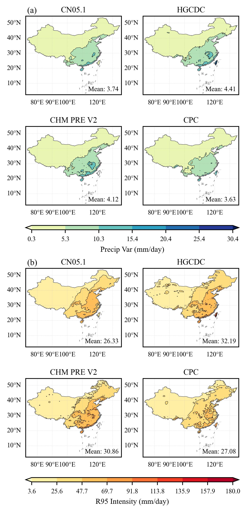
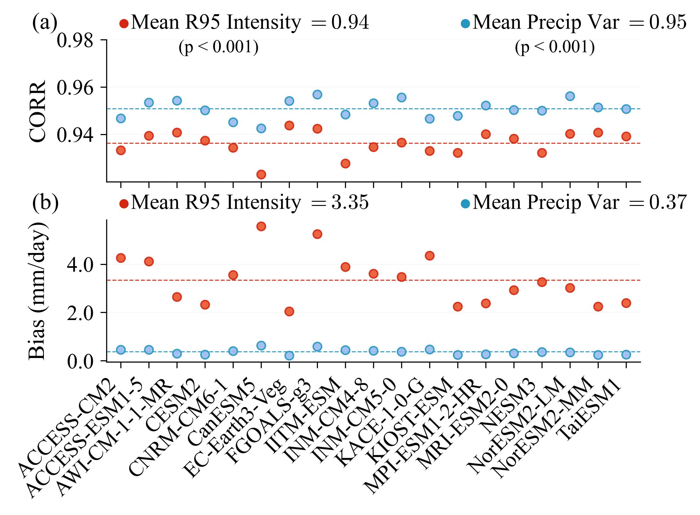
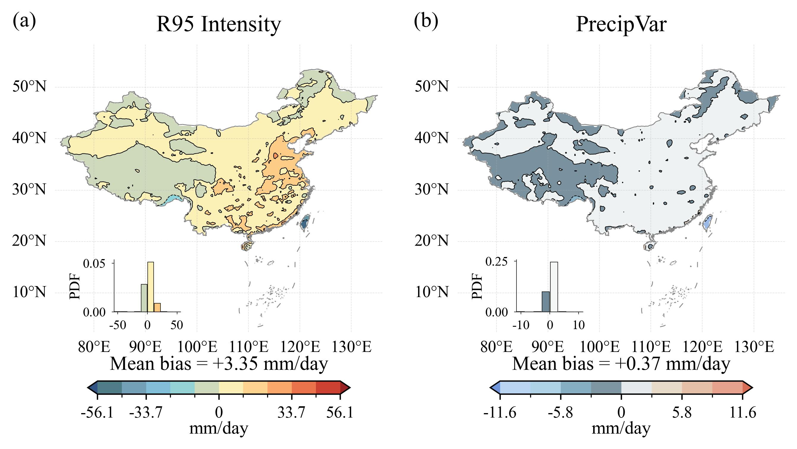
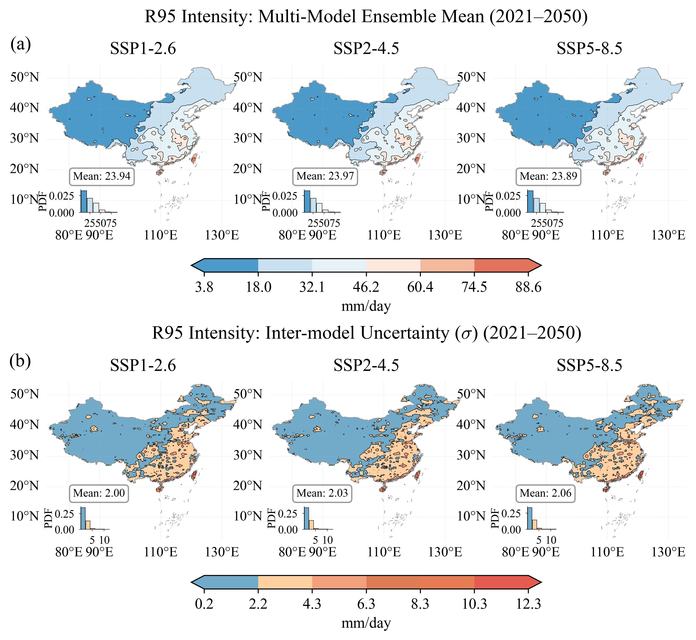
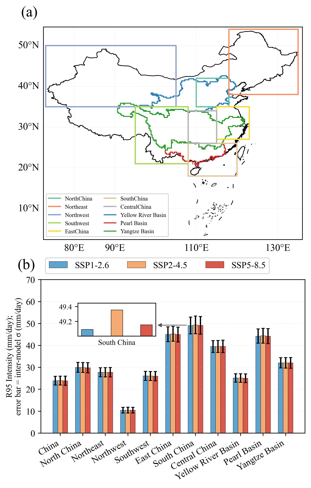
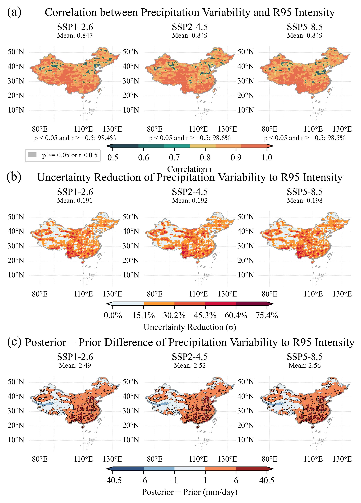
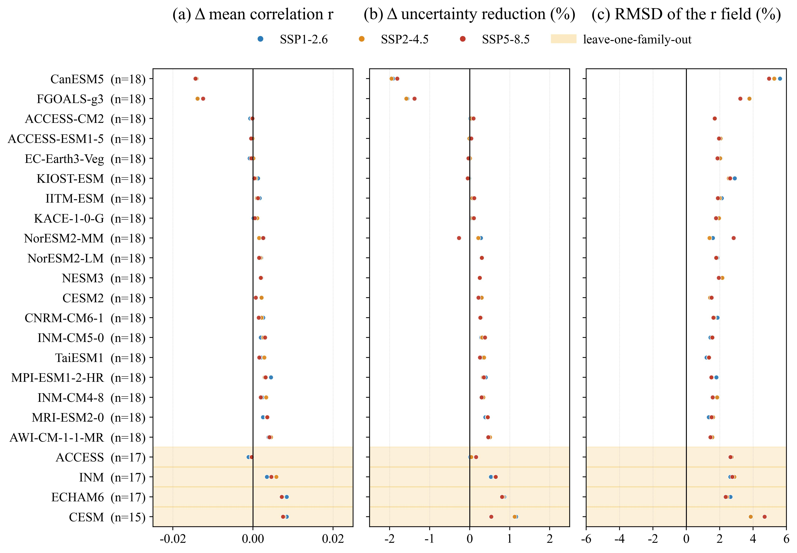
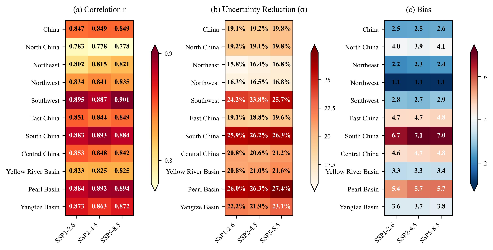
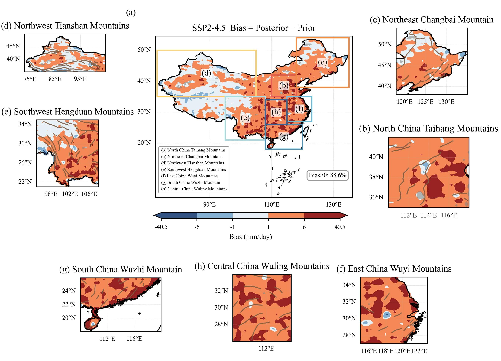
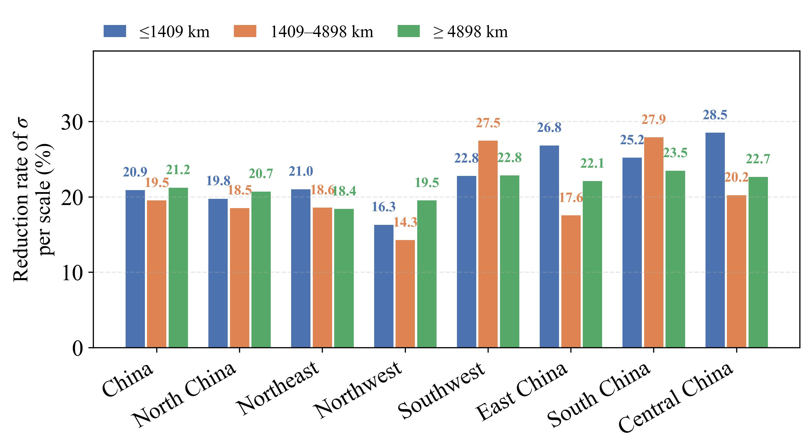

# Using hierarchical emergent constraints to reduce the uncertainty in future extreme precipitation projections over China

Haoran Yu¹, Linhao Zhong¹, Zhaohui Gong¹

¹National Institute of Natural Hazards, Ministry of Emergency Management of China, Beijing, 100085

*Corresponding author: Linhao Zhong (linhaozhong@ninhm.ac.cn)*

# Abstract

全球气候模式对区域尺度极端降水的未来预估仍存在较大不确定性，亟需发展有效的约束方法以提升预估可靠性。本研究基于HiCPC（High-resolution CMIP6 downscaled daily Climate Projections over China）降尺度数据集中19个第六次国际耦合模式比较计划（Coupled Model Intercomparison Project Phase 6, CMIP6）模式在SSP1-2.6（Shared Socioeconomic Pathway）、SSP2-4.5和SSP5-8.5这三种情景下的输出，以历史期（1981–2010）日降水变率为约束因子，采用分层涌现约束（Hierarchical Emergent Constraint, HEC）框架对中国未来（2021–2050）极端降水强度（R95mm Intensity）进行约束预估。

结果表明，历史降水变率与未来R95mm Intensity在超过98%的中国陆地区域呈统计显著相关（p<0.05），区域平均相关系数为0.78–0.90，其中西南地区最高（0.887–0.901），呈南高北低的空间格局。同时三个排放情景间的预估差异极小（中国陆地区域平均<0.1mm/day），表明不确定性主要来源于模式结构差异。基于上述模式层的涌现关系，本研究以四套格点降水观测产品为参考，将观测不确定性作为独立的一层，刻画降水观测产品自身的由站点密度、插值方案等带来的不确定性，发现观测数据对历史降水变率的气候态估计并不一致，区域平均3.63–4.41 mm/day，产品间差异约20%，其不确定性不可忽略。并在此基础上，聚焦由于模式结构与参数化的不确定性带来的模式不确定性，再经贝叶斯框架将其与上述涌现关系逐层整合。发现约束使模式间不确定性在各子区域平均缩减16%–27%，在涌现关系最强的区域局部缩减超过70%。进一步分析发现，约束调整的空间非均匀性与地形密切相关，如华北太行山呈现清晰的迎风坡正向调整、背风坡负向调整特征。因此本研究进一步基于二维离散余弦变换的尺度分解识别约束量的尺度断点，先由log–log斜率谱的曲率极大筛出候选断点，再依次剔除贴近网格尺度（<200 km）与相邻波长过于接近（Δlog₁₀λ<0.4）的候选，最终保留1409 km和4898 km两个特征尺度断点。分解后发现约束量的空间变率高度集中在小尺度（≤1409 km，方差份额占72.1%），并对各尺度分量的正向与负向贡献进行统计，发现约束量的正向调整均值为3.25 mm/day、负向调整均值为 −0.77 mm/day，其中正向调整73%来自中尺度和大尺度，而负向调整约80%来自小尺度。表明中、大尺度上的调整基本是单向的区域整体平移，而小尺度集中在局地的双向调整，导致空间变率几乎全在小尺度。进一步对先验与后验不确定性场作相同的尺度分解发现，约束使不确定性在全国范围平均下降20.7%，且三个尺度的缩减率相当接近（分别为 20.9%、19.5% 与 21.2%），表明HEC方法对不确定性的约束在全谱段同步发生。然而，受限于约0.25°的数据分辨率，HEC 在 200 km 以下（中-β 及以下）尺度上的调整无法从本数据中单独量化，这部分过程在本框架中仍处于未受约束状态；气候系统模式需改进对该尺度范围极端降水的刻画能力，这是进一步提高区域极端降水预估可靠性的重要路径。

# Plain Language Summary

气候变化背景下极端降水事件日益频发，但不同气候模式的未来预估存在显著分歧，给区域适应政策制定带来困难。本研究用分层涌现约束（HEC）压缩这种分歧：显式区分并分别量化观测不确定性与模式不确定性，而不把观测当作无误差的真值——这正是HEC区别于传统涌现约束之处。模式层用19个CMIP6模式（HiCPC降尺度数据）建立关系：以历史期（1981–2010）日降水变率为约束因子、未来期（2021–2050）极端降水强度（R95 Intensity）为目标；三个排放情景的预估差异很小（中国陆地平均不足0.1 mm/day），分歧主要来自模式本身。观测层则提醒一个常被忽略的事实：约束因子本身并非已知——四套独立格点降水产品对历史降水变率的气候态估计并不一致（产品间差异约20%），其产品间标准差除以√4（观测误差项）即观测不确定性σ_o；σ_o越大，观测权重越小、约束越弱。结果表明，两者在超过98%的中国陆地上显著正相关（西南和华南最强）；施加HEC后，模式间分歧在各区域平均缩小16%–27%，关系最强的区域局部超过70%。把调整场按尺度拆开可见一种分工：约1400 km 以下的小尺度承担约72%的空间变率，但正负调整几乎完全抵消，对净调整量几乎没有贡献；真正抬高整体预估的是约1400–4900 km 与更粗的尺度，表现为区域整体平移。不确定性的压缩则在全谱段同步发生：三个尺度（≤1400 km、1400–4900 km 与更粗尺度）的缩减率非常接近，都在 20% 上下（20.9%、19.5% 与 21.2%），说明约束并未偏爱某个特定尺度。调整还明显依赖地形：太行山、长白山、天山等山脉迎风坡上调、背风坡下调。受0.25°（约25 km）网格限制，200 km 以下的过程无法单独量化，仍需更高分辨率模式或动力降尺度来回答。总体而言，利用观测降水变率约束未来极端降水强度的量级预估，是提升中国区域极端降水预估可靠性的一条有效途径。


# 1 Introduction

在全球变暖背景下，极端降水事件的频率和强度普遍增强，对社会经济、生态系统和人民生命财产安全构成严重威胁。因此，准确预估未来极端降水的变化，是气候变化影响评估与适应性政策制定的核心科学问题之一。第六次国际耦合模式比较计划（Coupled Model Intercomparison Project Phase6, CMIP6）发布了最新一代全球气候模式（Global Climate Models, GCMs）的模拟与预估结果，是进行气候预估与研究区域水循环的关键工具<cite>[@eyring_overview_2016]</cite>。然而，尽管CMIP6在模式数量、分辨率和物理过程描述方面较前代有了显著提升，其对降水的模拟仍存在各种不确定性。这种不确定性在区域尺度上表现得尤为突出，不同模式对极端降水未来变化的预估存在显著离散，限制了预估结果的可靠性<cite>[@sillmann_understanding_2017]</cite>。研究表明，CMIP6模式对东亚夏季风降水的模拟离散度与大尺度环流背景的不确定性密切相关<cite>[@huang_inter-model_2022]</cite>，且模式对复合极端事件（如高温干旱并发事件）的模拟能力仍存在明显局限<cite>[@liu_evaluation_2025]</cite>。尤其在东亚区域，CMIP6多模式集合对极端降水的模拟存在系统性湿偏差，且模式间离散度较大<cite>[@kim_future_2025]</cite>，即便采用高分辨率High Res MIP模式，分辨率对极端降水预估的影响仍存在3–8%的差异<cite>[@liang_projections_2023; @zhang_resolution_2025; @hu_upgraded_2025]</cite>。

降水变率反映了降水在时间上的波动程度，其增强意味着干湿交替更加剧烈，极端事件更易发生。最新研究表明，在过去一个世纪中，全球约75%的陆地区域的降水变率已经显著增强，其中日尺度降水变率以每10年1.2%的速度增长，且这一增强主要归因于人为温室气体排放导致的大气增湿<cite>[@zhang_anthropogenic_2024]</cite>。降水变率作为约束因子的物理基础在于克劳修斯-克拉佩龙（Clausius-Clapeyron, CC）方程所描述的大气持水能力随温度增加而增加的热力学关系<cite>[@vergara-temprado_extreme_2021]</cite>。然而，近期研究表明，降水变率变化对极端降水天数的影响甚至超过了均值变化的影响，尤其在亚洲地区最为显著<cite>[@nordling_climate_2025]</cite>，且全球范围内约58%的陆地区域呈现降水频率减少但强度增加的趋势<cite>[@feldman_widespread_2026]</cite>。在中国区域，不同强度等级的日降水呈非均匀变化特征，西部地区各等级降水普遍增加，而东部地区轻–中级降水减少、重–极端降水增加的极化格局日益显著<cite>[@wang_non-uniform_2024]</cite>。与此同时，研究基于CMIP3/5模式发现，热带地区极端降水对气候变化的敏感性，与当前气候下极端降水对年际变率的响应之间存在强相关关系<cite>[@ogorman_sensitivity_2012]</cite>。通过观测到的年际变率敏感性进行约束，该研究将热带日极端降水对气候变化的敏感性约束为每开尔文约10%，显著缩小了模式间的预估范围。

涌现约束（Emergent Constraint）方法为减小气候预估不确定性提供了新的思路<cite>[@hall_progressing_2019]</cite>。该方法通过建立多模式中可观测的历史变量与未来待预估变量之间的统计关系，并利用观测数据对该关系施加约束，从而实现对未来预估的约束。该方法已在气候敏感度、碳循环反馈、区域降水变化等方面取得良好应用<cite>[@hall_progressing_2019]</cite>。近年来，涌现约束方法在极端降水领域取得了重要进展。研究利用近期全球增温趋势与降水趋势之间的涌现关系，将未来全球平均降水变化的方差缩减了8–30%<cite>[@shiogama_emergent_2022]</cite>；也有研究进一步证明历史极端降水频率的变化可用于约束其未来频率的增加，在中等排放路径（SSP2-4.5）下，全球极端降水事件到2100年将增加约32±8%<cite>[@thackeray_constraining_2022]</cite>；此外也有研究将这一框架从全球推广到大陆尺度，发现CMIP6模式普遍高估了历史增温，导致约束后的SSP5-8.5情景下极端降水增强幅度较原始预估减弱约25%、不确定性缩减约27%<cite>[@paik_emergent_2023]</cite>。也有研究发现历史降水变率可有效约束未来极端降水预估，将温带地区的不确定性缩减20–40%<cite>[@zhang_constraining_2022]</cite>；此外，基于历史全球增温趋势的约束研究发现，观测到的增温趋势可消除全球大部分陆地区域极端降水预估中超过40%的增温驱动不确定性<cite>[@li_constraining_2024]</cite>，进一步拓展了涌现约束方法的应用维度。最新研究进一步提出了联合涌现约束方法，结合温度相关和非温度相关的约束因子，将全球极端降水预估方差缩减42%<cite>[@shiogama_combined_2025]</cite>。也有研究提出了局地尺度的自适应涌现约束策略，使全球约90%人口所在区域的极端降水预估误差方差缩减超过20%<cite>[@li_increasing_2025]</cite>。

上述结果表明，当前可观测的降水变率特征可以为未来极端降水变化提供有效的物理约束。然而，前人研究也指出涌现约束在CMIP6新框架下的稳健性并非理所当然。前人研究系统评估了四种降水涌现约束从CMIP3/5到CMIP6的可迁移性，发现基于降水总量和印度夏季风的相关性等三种约束均未通过跨代际稳健性检验，仅基于降水变率敏感性的约束（ECG）在CMIP5和CMIP6中均保持稳健（相关系数r≈0.73–0.75）<cite>[@ferguglia_robustness_2023]</cite>。这一发现进一步增强了本文利用降水变率作为约束因子的科学依据。同时，针对中国区域涌现约束的研究也已取得初步进展。研究利用CMIP6模式分解中国东部夏季降水预估的经验正交函数，结合热带及西北太平洋历史降水进行约束，将不确定性缩减约23%<cite>[@zhu_improve_2024]</cite>；研究采用多种约束方案（含涌现约束和模式加权）对中国极端降水进行约束，实现了26–31%的不确定性缩减<cite>[@zhang_projections_2025]</cite>。针对中国西北干旱区，研究利用热带印度洋海温等物理约束因子，将西北地区夏季降水预估不确定性缩减了15–39%<cite>[@zhou_comparative_2024]</cite>。涌现约束方法也被拓展至中国干旱研究领域，研究表明其可有效约束未来气象、农业和水文干旱的预估<cite>[@xue_future_2024]</cite>。

基于上述背景，本研究旨在探讨降水变率是否可以作为涌现约束因子，降低CMIP6多模式下中国区域未来极端降水强度预估的不确定性。本研究将基于中国历史时期的降水变率观测数据，构建与未来极端降水强度之间的涌现关系，评估其统计显著性与物理机制，并量化约束前后预估不确定性的变化。研究结果有望为提升极端降水预估的可靠性提供新途径，并为区域气候变化适应策略的制定提供科学依据。

# 2 Data and Methods

分层涌现约束（Hierarchical Emergent Constraint, HEC）是一种被广泛应用的约束预估方法<cite>[@chai_constrained_2025]</cite>，它假设未来的某一气候变量与地球系统中某一观测变量的变率或趋势存在显著关系，通过该关系对未来的气候水文变化进行约束。该方法通过条件概率分布将未来气候、当前气候与观测数据联系起来，同时使我们能够充分考虑多套降水数据集的观测不确定性。

分层涌现约束方法的核心<cite>[@bowman_hierarchical_2018]</cite>在于，在地球系统模型集合中，识别出可观测气候要素$x$与描述未来模拟状态的重要变量$y$之间的强统计关系（式 (1)）。一旦从模型集合中诊断出这种涌现关系，就可将其应用于$x$的观测值，从而为$y$生成更可靠、更准确的未来气候预估（式 (3) 和 (4)）。其中HEC的分层体现在两个层面，一是观测层——使用多套独立观测数据集量化约束因子本身的观测不确定性。需要说明的是，HEC 与传统涌现约束的差别在于对观测误差项的处理：忽略观测误差会使回归的斜率与截距同时产生偏差、约束后的预测区间随之失真<cite>[@bowman_hierarchical_2018]</cite>；HEC 则保留该误差项，使后验均值与 σ 同时取决于相关 $\rho$ 与信噪比 $\mathrm{SNR}$。本研究据此把观测层作为独立的一层$\sigma_o$，且该误差不取单套资料的误差、也不用假定值，而由多套独立观测产品实测得到，并沿式 (1)–(5) 逐层传播到后验<cite>[@bowman_hierarchical_2018]</cite>。二是模式层——在CMIP6多模式集合中建立历史可观测变量与未来目标变量之间的涌现关系，并通过贝叶斯框架接收来自观测层的上层约束信息，对模式集合的未来预估施加分层约束。

具体展开而言，记约束因子为 $x$、目标变量为 $y$。则分层结构可显式地写为分级概率模型。观测层给出观测模型与似然：约束因子$x$只能通过观测获得，其观测模型为$x_{\mathrm{obs}} = x_{\mathrm{true}} + \varepsilon_o$，$\varepsilon_o \sim N(0, \sigma_o^2)$，即似然 $[x_{\mathrm{obs}} \mid x_{\mathrm{true}}] = N(x_{\mathrm{true}}, \sigma_o^2)$，其中$x_{\mathrm{true}}$为约束因子的真实值，$\sigma_o$为观测不确定性，并以此作为上层信息，模式集合给出的先验$x \sim N(\bar{x}, \sigma_x^2)$。其次对于模式层而言，在 $M$ 个模式的集合中，$x$ 与 $y$ 近似服从联合高斯分布，因此 $y$ 关于 $x$ 的条件分布,即涌现关系的似然的均值为下式、方差为 $\sigma_y^2(1-\rho^2)$ 的高斯分布。其中$a$使用公式（2）获得的，$\bar{x}$和$\bar{y}$分别是$x$和$y$的多模型集合平均值。这里$\rho$是$x$和$y$之间的相关系数；$\sigma_x$和$\sigma_y$分别是地球系统模型集合上$x$和$y$的标准差：

$$
y = a\,(x - \bar{x}) + \bar{y}
\tag{1}
$$

$$
a = \rho\,\frac{\sigma_y}{\sigma_x}
\tag{2}
$$

因此结合贝叶斯定理。后验和预测分布$[x_{\mathrm{true}} \mid x_{\mathrm{obs}}] \propto [x_{\mathrm{obs}} \mid x_{\mathrm{true}}]\,[x_{\mathrm{true}}]$，该分布仍为高斯分布，其均值为$\bar{x} + (x_{\mathrm{obs}}-\bar{x})/(1+\mathrm{SNR}^{-1})$，方差为$w=1/(1+\mathrm{SNR}^{-1})$。再对 $x_{\mathrm{true}}$ 边缘化（即对模式层积分），得到目标变量的后验预测分布$y \mid x_{\mathrm{obs}} \sim N(y_c, \sigma_{y_c}^2)$。约束后的未来地球系统变量$y_c$及其 σ 可分别用式 (3) 和式 (4)估算：

$$
y_c = \bar{y} + \frac{a}{1+\mathrm{SNR}^{-1}}\,(x_0 - \bar{x})
\tag{3}
$$

$$
\sigma_{y_c}^2 = \left(1 - \frac{\rho^2}{1+\mathrm{SNR}^{-1}}\right)\sigma_y^2
\tag{4}
$$

信噪比（Signal-to-Noise Ratio，SNR）定义了信号变率与噪声变率的相对强度，通过公式 (5) 估算，其中$\sigma_x^2$为模型间方差，$\sigma_o^2$为观测误差方差（多套观测数据集的方差）:

$$
\mathrm{SNR} = \frac{\sigma_x^2}{\sigma_o^2}
\tag{5}
$$

此外，为了研究极端降水和降水变率之间的涌现约束关系，本研究选择R95 Intensity作为衡量未来极端降水强度的指标。R95 Intensity是指根据气候变化检测和指数专家组（Expert Team on Climate Change Detection and Indices, ETCCDI）的定义，衡量极端降水的指标有R10mm、R20mm等10个指标 <cite>[@zhang_indices_2011]</cite>。然而，上述指标在描述一年内极端降水事件的强度方面仍显薄弱，缺乏对年内极端降水事件平均强度的量化。因此本研究定义了极端降水强度的指标R95 Intensity，它能够更直接、更稳定地刻画极端降水事件本身的物理强度特征，避免了单一使用总量或频次指标可能存在的片面性。具体含义如下式(6)，95%分位阈值在基准期内逐格点计算，且仅使用湿日样本（日降水量 $\geq 1$ mm/day），以避免干旱区因大量无降水日而系统性低估阈值；基准期湿日少于10天的格点，其阈值设为缺测。R95p表示一年内日降水量超过该阈值的累计降水量，R95d则为相应的降水日数。

同时为了量化降水变率，本研究选择Precip Var index作为衡量降水变率的指标。Precip Var index是指降水变率，被定义为经过预处理后日降水扰动序列的逐年时间标准差$\sigma(t)$，用于表征逐年降水日内与年际波动的整体强度（以下简称Precip Var）。为准确表征降水的波动强度及其长期变化特征，本研究根据已有研究<cite>[@zhang_anthropogenic_2024]</cite>，采用日降水变率作为衡量指标，首先对原始日降水序列进行预处理：先去除年循环，再去除长期线性趋势。在此基础上，对每个格点异常序列在本时段内进行最小二乘线性拟合，并扣除线性趋势项，得到无季节循环、无长期线性趋势的纯净扰动序列，并计算该序列的标准差（总体标准差，即以$D_t$为分母）。其中$t$为年份索引，$d$为日序（Day of Year），$D_t$为第$t$年的实际天数，$\bar{P}_d = \frac{1}{N}\sum_{y=1}^{N} P(y,d)$为该日序在本时段内的多年均值，$k(t,d)$为本时段内自第一天起按日递增的全局时间序号，$a,b$为对序列$\bigl[P(t,d)-\bar{P}_d\bigr]$进行本时段最小二乘线性拟合得到的系数。

$$
\mathrm{R95_{intensity}} = \frac{\mathrm{R95p}}{\mathrm{R95d}}
\tag{6}
$$

$$
\sigma(t) = \sqrt{\frac{1}{D_t}\sum_{d=1}^{D_t} \Bigl[\bigl(P(t,d)-\bar{P}_d\bigr) - \bigl(a + b\cdot k(t,d)\bigr)\Bigr]^2}
\tag{7}
$$

综上，本文采用分层涌现约束方法，以历史期（1981–2010）降水变率（Precip Var）作为约束因子，预估未来期（2021–2050）极端降水强度（R95 Intensity）。首先是观测不确定性，由于降水观测数据本身也存在极大的不确定性，不同数据集在中国区域极端降水估算中往往存在显著差异 <cite>[@wan_evaluation_2025]</cite>。因此为了准确衡量降水中观测数据的不确定性，本研究所使用的逐日降水观测资料包括四套数据，具体如表1所示。

表1 观测数据列表

| Dataset                          | Source |            Resolution            |
| :------------------------------- | :----- | :------------------------------: |
| CN05.1                           | CMA    | $0.25^\circ \times 0.25^\circ$ |
| HGCDC                            | TPDC   |  $0.1^\circ \times 0.1^\circ$  |
| CHM_PRE V2                       | TPDC   |  $0.1^\circ \times 0.1^\circ$  |
| CPC Global Unified Precipitation | NOAA   |  $0.5^\circ \times 0.5^\circ$  |

其中，CN05.1 由中国气象局基于 2400 余个地面站、以薄板样条与角距权重法插值生成，分辨率 $0.25^\circ$，已在各流域广泛验证 <cite>[@wu_changes_2017]</cite>。HGCDC 对全国站点资料做均一化处理以剔除迁站、城市化与仪器更替带来的非气候信号，并与 ERA5-Land 融合 <cite>[@zhang_homogenization_2023]</cite>；CHM PRE V2 基于 3476 个站点的长期日降水观测，结合 11 个降水相关变量与 LGBM 机器学习方法构建 <cite>[@hu_upgraded_2025]</cite>，与 HGCDC 同为 $0.1^\circ$。CPC Global Unified 由 NOAA/CPC 发布，融合地面雨量站、卫星反演与 NCEP 再分析并采用最优插值客观分析 <cite>[@xie_gauge-based_2007]</cite>，分辨率为 $0.5^\circ$。计算四套产品在 1981–2010 年的 Precip Var 与 R95 Intensity 气候态见图 1；产品间离散度在同一脚本内计算并留档，用于量化观测误差。四套产品在中尺度空间格局上高度一致，均呈南高北低、东高西低的空间特征，但量级差异明显：Precip Var 的区域平均为 3.74（CN05.1）、4.41（HGCDC）、4.12（CHM PRE V2）与 3.63（CPC）mm/day；R95 Intensity 为 26.33、32.19、30.86 与 27.08 mm/day，产品间差异约 20%，说明约束因子自身的观测不确定性不可忽略。需要明确的是，观测层要刻画的是"被代入回归的那个观测值"本身有多不确定：本文代入的是四套产品的格点均值，故 $\sigma_o$ 取产品间标准差除以 $\sqrt{N}$（$N$ 为该格点可用产品数，通常为 4；该量即本文所称的观测误差项，observational error term），其前提是把四套产品视为同一真值的独立估计；若认为它们各自代表不同的"真值"（站点网、插值方案与地形代表性差异不可忽略），则应改用产品间标准差，此时 $\sigma_o$ 约增大一倍、约束相应减弱。观测不确定性（四套产品在同一格点上的离差）不再单独出图，其量值直接进入 $\sigma_o$ 的计算。

<figure>
    
    <figcaption>
    Fig.1 观测层的四套格点降水产品对约束因子与目标变量的气候态刻画（1981–2010 年）。(a) Precip Var：四套产品按 2×2 排列（左上 CN05.1、右上 HGCDC、左下 CHM PRE V2、右下 CPC）；(b) R95 Intensity：与 (a) 同布局。各面板标注面积加权区域平均值；填色等值线叠加中国矢量边界，色带分级与图层一致。
    </figcaption>
</figure>

为满足极端降水研究的需要，本研究使用HiCPC（High-resolution CMIP6 downscaled daily Climate Projections over China）数据集<cite>[@yuan_hicpc_2024]</cite>，并选择其中历史（1981–2010）和未来（2021–2050）进行研究。CMIP6采用了精心设计的实验方案，包括不同情景下的历史模拟和未来预估<cite>[@eyring_overview_2016]</cite>，而ScenarioMIP提供了统一的共享社会经济路径（Shared Socioeconomic Pathway, SSP）框架<cite>[@oneill_scenario_2016]</cite>，使得多模式多情景的对比分析具有科学一致性。该数据集是对原始CMIP6模式输出进行了逐日偏差校正，显著改善了日降水量的概率分布特征及其极值表现，从而为极端降水事件的识别与分析提供了更为可靠的数据基础，适用于中国复杂地形区域的精细化气候研究。为了估计未来温室气体排放路径的响应，我们使用三种不同的排放情景，即SSP1-2.6（低排放路径）、SSP2-4.5（中等排放路径）和SSP5-8.5（高排放路径），并比较结果。需要说明的是，HiCPC 的偏差订正与空间降尺度以中国气象强迫数据集（China Meteorological Forcing Dataset, CMFD）为参考观测，而本文用于量化观测不确定性、并作为 HEC 观测层输入的是 CN05.1、CPC、CHM PRE V2 与 HGCDC 四套产品；尽管都部分依赖中国地面气象站观测，二者并非同一套数据。

此外为了验证HiCPC数据在中国区域的R95 Intensity与降水变率（Precip Var）研究中的适用性，本研究以CN05.1观测数据为参考，对历史时期（1981–2010年）HiCPC的日降水输出开展独立评估。研究中使用CN05.1是因为其对中国地区极端降水的评估比较准确。评估方式采用Pearson correlation coefficient（CORR）和偏差（Bias）两项指标进行定量评估。

本研究首先分别计算每个HiCPC模式在历史时期（1981–2010年）的降水变率（Precip Var）和极端降水强度（R95 Intensity），以及CN05.1观测的对应指标。其次，在对HiCPC粗化处理以统一分辨率为$0.25^\circ \times 0.25^\circ$的基础上，将每个模式的指标场与CN05.1观测场逐格点对比，并以格点纬度的余弦为面积权重计算空间相关系数（CORR）和偏差（Bias），得到19个模式的两个空间统计指标，进而通过散点图展示19个模式各指标的分布及均值（图 2）。然后，对19个HiCPC模式取等权集合平均（Multi-Model Ensemble, MME），将MME的指标与观测进行逐格点对比，同样以面积加权计算空间相关系数和偏差，以评估MME的整体表现。

<figure>
    
    <figcaption>
    Fig.2 依据历史时期（1981–2010）观测CN05.1数据对HiCPC多模式的对比评估。散点图给出19个CMIP6模式在中国区域的降水变率（PrecipVar index，蓝色）与极端降水强度（R95 Intensity，红色）相对于CN05.1观测的相关系数（CORR，上行）和偏差（Bias，mm/day，下行）两项评估指标；横轴为19个模式，水平虚线为各指标的19模式平均值，每个子图上方标注该平均值。
    </figcaption>
</figure>


图2的评估结果表明，HiCPC中19个模式集合与观测数据在降水变率和极端降水强度两个指标上的相关性整体均处于较高水平（$p<0.001$）。就19个模式分别与观测对比的均值而言，降水变率与极端降水强度的空间相关系数分别为0.951与0.936，偏差分别为0.37与3.35 mm/day（$p<0.001$），表明极端降水强度的偏差明显大于降水变率。多模式集合平均（MME）的评估进一步表明，HiCPC的MME在极端降水强度上与CN05.1观测具有较高的空间一致性，能够较好再现极端降水的空间分布格局，但MME强度整体偏低（观测均值26.37 mm/day 对应 MME 23.01 mm/day，约13%）。

图3表明，总体来看，HiCPC对降水变率的模拟表现较好，而对极端降水强度仍存在偏差。就全国面积加权平均而言，偏差（OBS − MME）在极端降水强度上为 +3.35 mm/day、在降水变率上为 +0.37 mm/day，分别相当于各自观测气候态（26.37 与 3.75 mm/day）的 12.7% 与 9.9%；两类偏差均以模式低估为主，OBS − MME > 0 的面积占比分别为 67.9% 与 71.2%。这可能与数据中使用的偏差校正与空间降尺度方法<cite>[@thrasher_nasa_2022]</cite>对极端降水尾部概率的刻画不足有关<cite>[@yuan_hicpc_2024]</cite>。这为本研究利用观测到的降水变率对极端降水强度进行约束提供了数据基础，同时鉴于其较高的空间相关性和可接受的误差，HiCPC数据可用于后续基于针对中国区域的极端降水和降水变率的研究。


<figure>
    
    <figcaption>
    Fig.3 历史时期（1981–2010）HiCPC多模式集合平均（MME）与CN05.1观测在降水变率（PrecipVar）和极端降水强度（R95 Intensity）上的偏差空间分布（Bias = OBS − MME）。(a) 为极端降水强度（R95 Intensity）的偏差场，(b) 为降水变率（PrecipVar）的偏差场；等值线填色图叠加中国矢量边界，色带以0为中心对称分级，蓝色表示MME高估（负偏差），红色表示MME低估（正偏差），各面板左下角嵌入PDF直方图展示偏差值的分布特征，色带上方标注面积加权区域平均偏差值，色标单位分别为mm/day与σ (mm/day)。
    </figcaption>
</figure>

在上述评估的基础上，进一步刻画 2021–2050 年极端降水强度预估本身的量级与模式间分歧——它既是目标变量的先验分布，也是后验收缩的基准。本研究使用HiCPC数据集提供的19个CMIP6模式在三个共享社会经济路径（SSP1-2.6、SSP2-4.5、SSP5-8.5）下的逐年R95 Intensity输出，以2021–2050年为未来预估时段，在每个格点上分别计算多模式集合平均与模式间不确定性（σ），即衡量R95 Intensity的不确定性。集合平均反映了模式对极端降水强度预估的一致性信号，而模式间不确定性（σ）则量化了因模式结构差异带来的预估离散程度。在此基础上，进一步对比不同排放情景下各统计量的空间分布差异与相似性。

2021–2050年，19个HiCPC模式对R95极端降水强度的多情景预估在空间型上总体一致，但量级上存在显著的模式间分歧，见图 4所示。依据标准七大地理分区及三大流域划分10个评估区域（图 5a，柱状图另以中国全域作参考），进而计算各区域的面积加权区域平均（图 5b）。研究发现，极端降水强度呈东南高、西北低的阶梯状分布：华南地区最高（约49.2 mm/day），华东次之（约45.1 mm/day），华中约39.5 mm/day，华北约30.0 mm/day，东北约27.8 mm/day，西南约26.0 mm/day，西北地区最低（约10.5 mm/day）。三大河流流域中，珠江流域平均强度约44.3 mm/day，与华东相当；长江流域约32.1 mm/day，与华北接近；黄河流域约25.1 mm/day，位于东北与西南之间。三大流域平均强度自南向北递减（珠江 $>$ 长江 $>$ 黄河），与子区域的空间梯度一致。总体上，极端降水强度呈现南高北低、东高西低的分布格局，反映距水汽源远近和青藏高原地形的共同影响。

同时三个排放情景（SSP1-2.6、SSP2-4.5、SSP5-8.5）在2021–2050年间的全区域平均差异极小（$<$ 0.1 mm/day），各区域差异亦不超过0.3 mm/day，表明该时段极端降水强度的不确定性主要来源于模式结构差异，而非排放路径选择。模式间不确定性（σ）同样呈现东南高、西北低的格局（全国平均约 2.0–2.1 mm/day）：华南最大（约3.8–4.0 mm/day），华东约3.4 mm/day，华中约2.7–2.9 mm/day，华北约2.2–2.3 mm/day，东北约2.1 mm/day，西南约2.0–2.1 mm/day，西北最小（约1.3 mm/day）；珠江流域约3.3–3.4 mm/day，长江流域约2.3–2.4 mm/day，黄河流域约1.9–2.0 mm/day；空间最大值在三个情景下分别为10.64、10.83与12.33 mm/day，表明极端降水越强的区域，模式间的绝对分歧越大，预估的离散度相应升高。此外不同排放情景下各区域不确定性（σ）近乎一致，进一步确认该时段模式结构差异是极端降水预估不确定性的主导来源，其影响远大于排放路径的贡献。

<figure>
    
    <figcaption>
    Fig.4 HiCPC 多模式集合对中国区域 2021–2050 年极端降水强度（R95 Intensity）的预估及模式间不确定性。(a) 三个 SSP 情景（SSP1-2.6、SSP2-4.5、SSP5-8.5）下 R95 Intensity 的多模式集合平均（MME）空间分布，等值线填色图叠加中国矢量边界，下方为共用色带，左下角嵌入 直方图（分箱与色带分级一致，覆盖数据全域），面板内标注该情景的面积加权区域平均值（Mean）。(b) 对应 (a) 三个情景的模式间不确定性（σ，Inter-model Standard Deviation）空间分布，同样标注面积加权区域平均值，暖色表示模式间分歧更强、预估可信度更低。
    </figcaption>
</figure>

<figure>
    
    <figcaption>
    Fig.5 中国七大地理分区及2021–2050年极端降水强度（R95 Intensity）的区域统计。(a) 中国标准七大地理分区（华北、东北、西北、西南、华东、华南、华中）的空间范围框（各框以不同颜色区分，互不重叠）及名称，叠加三大河流流域矢量边界（黄河、长江、珠江）。(b) 各分区及三大流域面积加权平均的极端降水强度（mm/day）柱状图（另以中国全域作参考），颜色区分三个SSP情景（SSP1-2.6、SSP2-4.5、SSP5-8.5），误差棒表示模式间不确定性（σ），体现各区域不同排放路径下模式集合的预估量级与离散度；左上角嵌入子图放大展示华南地区三个情景间的微小差异（纵轴按三情景范围缩放，极差0.26 mm/day）。
    </figcaption>
</figure>


综述所述对于模式不确定性，模式集合的统计量即由上述 19 个模式给出：以历史期（1981–2010）降水变率为自变量 $x$、以未来期（2021–2050）极端降水强度为因变量 $y$，在 19 个模式上回归得到式 (1)、(2) 所需的 $\bar{x}$、$\sigma_x$、$\bar{y}$、$\sigma_y$、$\rho$ 与 $a$；逐格点的相关系数 $r$ 与显著性 $p$。

# 3 Results

## 3.1 Hierarchical Emergent Constraints

基于层次涌现约束（HEC）在各格点的诊断结果，对三个SSP情景分别计算相关系数、不确定性缩减率及调整场（调整量 = 后验均值 − 先验均值），并筛选$p<0.05$且$r\geq0.5$的统计显著格点。图 6展示了三个SSP情景下相关系数、不确定性缩减率和调整量的空间分布，相关性与约束结果均仅保留通过显著性检验（$p<0.05$）且$r\geq0.5$的格点。结果表明，相关系数在超过98%的中国陆地区域达到统计显著（$p<0.05$），空间上呈南高北低的分布格局，西南地区和华南部分地区相关系数超过0.88，东北和西北地区相对较低。本节报告的逐格点缩减率为 $\Delta = 1 - \sigma_{\mathrm{post}}/\sigma_{\mathrm{prior}}$，其中 $\sigma_{\mathrm{prior}}$ 为 19 个模式的模式间标准差（先验不确定性）、$\sigma_{\mathrm{post}}$ 为后验标准差（见 2.3 节）。不确定性缩减率空间分布与相关系数高度一致，高缩减区集中于西南、华南和珠江流域，局部格点超过 70%，而东北和西北地区整体偏低。调整场（后验$-$先验）显示约束调整均为正值，华南和华东沿海调整幅度最大（超过5 mm/day），向西北内陆递减至1 mm/day以下，与极端降水强度本身的空间分布一致，上述空间分布特征在各排放情景间高度一致。与此同时，将本研究的约束结果与前人研究进行相互印证，发现本研究中华南等强相关区域的不确定性（σ）缩减率（26%–27%）与已有研究对中国东部夏季降水实现的约23%缩减率接近<cite>[@zhu_improve_2024]</cite>，但略低于相关研究利用多种约束方案获得的26–31%缩减率<cite>[@zhang_projections_2025]</cite>。需要指出的是，本研究同时采用了四套观测数据（CN05.1、CPC、CHM PRE V2和HGCDC）以量化观测不确定性，比仅采用单一观测数据集的约束方法更为保守，这在一定程度上降低了名义缩减率，但提高了约束结果的稳健性。此外，在全球尺度的研究表明，约束后全球极端降水增强的方差缩减约27%<cite>[@paik_emergent_2023]</cite>；把本研究的缩减率换算为方差缩减率（$\Delta_{\sigma^2} = 1 - \sigma^2_{\mathrm{post}}/\sigma^2_{\mathrm{prior}}$），各区域为 28%–44%（全国平均 33%），与上述结果处于相近量级。
<figure>
    
    <figcaption>
    Fig.6 分层涌现约束框架下降水变率与极端降水强度相关关系及不确定性缩减评估。(a) 1981–2010 年降水变率（Precipitation Variability）与 2021–2050 年极端降水强度（R95 Intensity）在三个 SSP 情景（SSP1-2.6、SSP2-4.5、SSP5-8.5）下的相关系数空间分布，灰色掩膜覆盖未通过显著性检验（p ≥ 0.05）或弱相关（r < 0.5）的格点，等值线勾勒相关系数分级界线，右下角标注面积加权区域平均相关系数，整图右下角灰色图例说明掩膜含义。(b) 对应 (a) 三个情景下通过分层涌现约束后的极端降水强度预估不确定性（σ）缩减率（Uncertainty Reduction of σ）空间分布。缩减率逐格点计算：$\Delta = 1 - \sigma_{\mathrm{post}}/\sigma_{\mathrm{prior}}$，其中 σ_prior 为 19 个模式未来极端降水强度预估的模式间标准差（先验不确定性），σ_post 为贝叶斯更新后的后验标准差，由两层涌现约束的闭式解给出 σ_post = σ_prior × √(1 − r²/(1 + 1/SNR))；式中 r 为该格点的涌现相关系数，SNR = σ_x²/σ_o,eff² 为约束因子（历史降水变率）模式间方差与观测层有效方差之比，σ_o,eff 取四套观测产品间的标准差除以 √N（N 为该格点可用产品数，即观测误差项）。当观测视为无误差（σ_o,eff → 0，SNR → ∞）时该式退化为经典涌现约束的 1 − √(1 − r²)；本文显式保留 σ_o,eff，故所得缩减率更为保守。子图上方标注的 Mean 为按 cos φ 面积加权、在有效格点（p < 0.05 且 r ≥ 0.5，即各图着色区域）上统计的区域平均值。灰色掩膜覆盖未通过显著性检验（p ≥ 0.05）或弱相关（r < 0.5）的格点，与 (a) 一致。(c) 后验与先验均值差异（Bias）空间分布，反映涌现约束对各格点极端降水强度估值的调整幅度与方向，灰色掩膜判据同 (a)、(b)，上方 Mean 亦为有效格点上的面积加权平均。</figcaption>
    </figcaption>
</figure>

多模式集合是典型的“机会集合”，模式之间并非相互独立：同一机构可能维护前后两代模式（如 INM-CM4-8 与 INM-CM5-0），不同机构的模式也可能共用公共分量或代码谱系（NorESM2-LM、NorESM2-MM 与 TaiESM1 均源自 CESM 谱系；MPI-ESM1-2-HR 与 AWI-CM-1-1-MR 共用 ECHAM6 大气分量）。这种聚类会使回归关系被少数近亲模式主导，即所谓的杠杆效应<cite>[@sansom_constraining_2021]</cite>。因此，有必要检验图 6 的涌现约束结论是否依赖于集合中的某一个模式或某一簇同源模式。

为此，本研究设计了 25 组集合试验：全集合参照（19 个模式）、逐个剔除单个模式的留一试验（leave-one-model-out, LOMO，19 组，每组 18 个模式）、逐个剔除一个模式家族的留一试验（leave-one-family-out, LOFO，4 组），以及一项家族边界敏感性试验。家族划分依据模式命名、所属机构与已知共用分量，取保守口径：ACCESS 家族（ACCESS-CM2、ACCESS-ESM1-5）、CESM 谱系（CESM2、NorESM2-LM、NorESM2-MM、TaiESM1）、INM 家族（INM-CM4-8、INM-CM5-0）与共用 ECHAM6 大气分量的组合（MPI-ESM1-2-HR、AWI-CM-1-1-MR）；其余 10 个模式在本集合中无同源伙伴，各自成组。敏感性试验把谱系归属尚有争议的 TaiESM1 从 CESM 谱系中摘出，仅保留 CESM2、NorESM2-LM 与 NorESM2-MM。每一组试验都在逐格点上完整重算式 (1)–(5)，即重新拟合 $\bar{x}$、$\sigma_x$、$\bar{y}$、$\sigma_y$、$\rho$，重新计算后验均值、后验方差与不确定性缩减率，再与全集合参照场逐格点比较。需要说明的是，本节沿用式 (1)–(5) 的闭式解，未补充留一预测所需的有限样本修正项；本节关注的是空间场对集合成员的敏感性，而非预测区间的标定。

结果表明，图 6 的三条诊断量对集合成员的选择均不敏感（图 7）。全国面积加权平均相关系数在全集合下为 0.847–0.849（三个情景），在 24 组剔除试验中仅在 0.833–0.857 之间变动，最大绝对变幅 0.014、相对变幅不超过 1.7%；面积加权平均不确定性（σ）缩减率在全集合下为 19.2%–19.8%，在剔除试验中位于 17.2%–20.6% 之间，最大绝对变幅 2.0 个百分点；达到 $p<0.05$ 且 $r\ge0.5$ 判据的面积比例始终不低于 97.1%（全集合为 98.5%–98.7%）。空间型的变化更小：24 组剔除试验的相关系数场与参照场的型相关系数最低为 0.907，不确定性缩减率场最低为 0.957，两者在场平均意义上几乎不可区分。

逐格点的不稳定被限制在局部：相关系数偏离参照场超过 0.10 的面积占比中位数仅 0.5%（最极端算例 7.1%），不确定性缩减率偏离超过 5 个百分点的面积占比中位数仅 0.8%（最极端算例 18.4%），而后验减先验调整场发生符号翻转的面积占比始终低于 0.7%。也就是说，即便在影响最大的剔除试验中，图 6 的空间格局仍可辨认，只是少数邻近分级边界的格点发生了类别迁移。

剔除对象之间存在系统性的影响差异。单个模式中，CanESM5 与 FGOALS-g3 的影响显著大于其余模式，且两者量级相当：剔除 CanESM5 会使全国平均相关系数由 0.849 降至 0.835、全国平均缩减率由 19.2% 降至 17.3%；剔除 FGOALS-g3 的结果与之接近（$\Delta r=-0.014$）；二者的影响约为第三位模式（AWI-CM-1-1-MR，$\Delta r\approx0.005$）的 3 倍，其余 17 个模式剔除后全国平均相关系数的变化均不超过 0.004。模式家族中，成员最多的 CESM 谱系影响最大，但整族剔除（集合仅余 15 个模式）也只使全国平均相关系数变化 +0.008、缩减率变化 +0.011；把 TaiESM1 摘出后的敏感性试验给出同向同量级的结果（$\Delta r=+0.002$ 至 $+0.003$），说明家族边界的划定方式不改变结论。三个排放情景的结论高度一致。

区域尺度上，南高北低的约束效果格局在最严格的剔除条件下依然成立：把华南、珠江、西南与长江划为南方组，东北、华北、西北与黄河划为北方组，在 3 个情景 × 25 组集合的 75 次比较中，南方组的最小值始终高于北方组的最大值，余量最小为 0.03 个百分点（缩减率，SSP2-4.5，剔除 FGOALS-g3）。各区域在全部剔除试验中的面积加权平均相关系数均不低于 0.768、不确定性缩减率均不低于 12.2%（两者均出现在东北）；变幅最大的区域为东北（相关系数极差 0.055），最小的是长江流域（0.024），即约束较弱的区域对集合成员更为敏感。

综上，图 6 呈现的涌现约束关系并非由某一个模式或某一簇同源模式支撑。需要如实指出的是，CanESM5 与 FGOALS-g3 确为杠杆点，因此本文在报告全国平均量时给出含与不含 CanESM5 的两组数值（缩减率分别为 19.2% 与 17.3%），并说明 FGOALS-g3 的影响与之相当，而不将结论表述为“不受任何单个模式影响”。


<figure>
    
    <figcaption>
    Fig.7 排除单个模式或模式家族后分层涌现约束诊断的稳健性。纵轴为 23 组剔除试验（19 组逐个剔除单个模式、4 组逐个剔除模式家族；括号内为剔除后的集合大小），先列单模式、后列模式家族，两组内部均按全国面积加权平均相关系数的变化 Δr 排序（家族边界敏感性试验未绘入本图）；圆点颜色区分三个 SSP 情景（SSP1-2.6、SSP2-4.5、SSP5-8.5），黄色底纹标示 leave-one-family-out 试验。横轴分别为 (a) 全国平均相关系数的变化 Δr、(b) 全国平均不确定性（σ）缩减率的变化（单位：%，即百分点），以及 (c) 相关系数场相对全集合参照场的均方根偏差（RMSD，以 r 单位的百分数表示，即 3% 表示 RMSD = 0.03）。除 CanESM5（LOMO）与 CESM 谱系（LOFO）外，其余剔除试验对全国平均量的影响均小于 0.005。
</figure>


根据区域热力图（图 8）可知，三个情景下各子区域和河流流域的历史Precip Var与未来R95 Intensity均呈显著正相关，面积加权区域平均相关系数普遍在0.78–0.90之间，且情景间差异极小。高相关区域（r > 0.88）主要集中于西南地区、华南、珠江流域和青藏高原，其中西南地区最为突出（0.887–0.901），表明这些区域历史降水变率对未来极端降水强度具有较强的约束能力；东北和华北地区相关系数相对较低（约0.78–0.82）。总体上，相关系数呈现南高北低的空间格局，与极端降水强度本身的分布特征一致。对于不确定性缩减而言，各区域不确定性（σ）缩减率在 16%–27% 之间，同样呈南高北低的分布：华南和珠江流域缩减率最高（约26%–27%），东北地区最低（约16%–17%），说明分层涌现约束在高相关区对模式预估离散度的压缩效果更为显著。调整场显示，涌现约束对各区域极端降水预估值均为正向调整（后验 > 先验），其中华南和珠江流域调整幅度最大（约5.4–7.1 mm/day），西北最小（约1.0–1.1 mm/day），表明约束对高降水区的调整更为明显。上述结果进一步验证了分层涌现约束在中国区域的适用性，且其约束效果存在显著的空间依赖性——气候越湿润的地区，约束效果越强。上述区域统计结果揭示了相关系数、不确定性缩减和调整量在不同区域间的系统性差异，但区域平均的视角掩盖了约束效果在空间上的细致变化。
<figure>
    
    <figcaption>
    Fig.8 10个子区域/流域在三个SSP情景下的约束效果热力图，展示三个关键统计量：(a) 相关系数（Correlation r），(b) 不确定性（σ）缩减率（Uncertainty Reduction of σ，单位%），(c) 后验−先验调整量（Bias = Posterior − Prior，单位mm/day）。行方向排列11个区域（中国全域、华北、东北、西北、西南、华东、华南、华中、黄河流域、珠江流域、长江流域），列方向排列三个SSP情景（SSP1-2.6、SSP2-4.5、SSP5-8.5）。各单元格内标注数值，颜色深浅反映统计量相对大小，直观对比不同区域和情景间的约束效果系统性格局。
    </figcaption>
</figure>


上述区域统计结果揭示了相关系数、不确定性缩减和调整量在不同区域间的系统性差异，但区域平均的视角掩盖了约束效果在空间上的细致变化。因此，为进一步揭示调整场的空间结构，图 9给出了SSP2-4.5情景下后验与先验均值差异（Bias）的全中国及多个子区域分区空间分布。该图不仅展示了后验调整量从东南沿海向西北内陆递减的总体格局，还通过各分区放大视图叠加区域主要山脉，以评估地形对约束调整幅度的影响。图9的结果表明，SSP2-4.5情景下R95 Intensity后验−先验调整量的地形依赖性在不同区域存在显著差异：华北太行山、东北长白山及西北天山沿线均表现出清晰的迎风坡正向调整增强特征；而华东武夷山、华南五指山及华中武陵山区域，调整量的空间分布与地形之间的对应关系并不明显，约束调整幅度主要由大尺度环流背景而非局地地形主导。而已有研究表明，东亚区域的地形降水偏差与模式中地形拖曳参数化方案密切相关——研究发现采用三维地形各向异性拖曳方案可缓解东亚地区约25–50%的过量降水偏差<cite>[@xie_impact_2025]</cite>，尤其在青藏高原及其周边区域效果显著。研究进一步指出，高分辨率模式（25–50 km）通过改善地形解析度可将青藏高原降水湿偏差降低约50%<cite>[@chen_better_2024]</cite>，主要机制为更准确的地形对低层风场的阻挡和雨影效应。在区域气候模式中引入各向异性地形因子参数化方案，也可将青藏高原西部冬季降水湿偏差降低约6–17%<cite>[@gu_wet_2026]</cite>，进一步证实了复杂地形区降水模拟偏差与次网格地形拖曳过程之间的物理联系。上述机制与本研究的调整格局一致：迎风坡呈正向调整、背风坡呈负向调整，提示地形阻挡过程的刻画不足是这些区域后验调整的可能物理来源。

但上述区域间山脉响应的不一致性表明，分层涌现约束的调整作用并非对所有尺度的降水过程均等有效。为厘清约束主要作用于何种尺度——是受地形强迫的次天气尺度过程，还是受大尺度环流控制的天气尺度乃至行星尺度过程——因此本研究接下来从尺度分解的视角出发，对后验$-$先验调整场进行多尺度分离，分别计算各个尺度在各个区域的总调整量中的占比，以识别分层涌现约束调整的主要尺度窗口及其物理机制。

<figure>
    
    <figcaption>
    Fig.9 分层涌现约束（HEC）在 SSP2-4.5 情景下对极端降水强度（R95 Intensity）的调整量（Bias = Posterior − Prior）。(a) 全国分布，线框为七个分区，编号 (b)–(h) 与左侧图例对应，自 (b) 至 (h) 依次为华北太行山、东北长白山、西北天山、西南横断山、华东武夷山、华南五指山、华中武陵山；右下角为正向调整格点占比。(b–h) 各分区放大图，叠加区内主要山脉矢量。
    </figcaption>
</figure>

## 3.2 Scale decomposition of the constraint adjustment

极端降水事件是多尺度大气过程相互作用的结果——大尺度环流系统，如东亚夏季风、西太平洋副热带高压，决定了水汽的经向和纬向输送背景，而中-α 尺度过程（200–2000 km），如中尺度对流系统、西南低涡与地形强迫，则塑造了极端降水的区域尺度空间格局。传统的极端降水分析通常聚焦于年极端降水总量或频率的总体空间格局，但难以区分不同空间尺度过程对极端降水空间变率的相对贡献。2D DCT等尺度分解方法在降水场分析中已得到应用。研究利用二维小波分解对全球再分析资料的区域日降水强度和空间结构进行了多尺度分析，发现强降水事件在近20年中呈现增强趋势并伴随着空间范围的收缩，且在近20年呈加速趋势<cite>[@lussana_changes_2024]</cite>。也有研究提出的空间变异系数（SCV）框架进一步从全球尺度揭示了降水空间不均匀性的持续增长趋势<cite>[@liu_general_2025]</cite>。因此为进一步探究分层涌现约束调整作用的尺度选择性，本文引入二维离散余弦变换（2D DCT）方法，对中国区域的极端降水强度及后验$-$先验调整场进行多尺度分解，分别提取尺度分量，以期识别约束调整的主要尺度窗口及其物理机制。

对SSP2-4.5场景下的Bias场进行2D DCT谱分析。对数分箱后获41个有效谱点，波长范围约34–12900 km。方差谱在对数–对数坐标下呈分段幂律结构（图10a）。断点识别分三步：先对log–log斜率谱逐点计算二阶差分$|\Delta^2 s|$，取其局部极大值（阈值$>1.0$）作为候选断点，共得7个；再剔除波长小于200km（接近网格尺度）的候选；最后按对数波长间距$\Delta\log_{10}\lambda<0.4$剔除聚类冗余，最终保留1409km和4898km。上述识别过程中，曲率阈值取 1.0用于筛出显著高于二阶差分背景波动的转折，两项过滤容差分别为 200 km 接近本文 $0.25^\circ$ 网格可分辨的尺度上限，用以排除网格尺度噪声与 $\Delta\log_{10}\lambda<0.4$ 则保证相邻候选点之间存在约 2.5 倍的波长间隔，避免把同一物理尺度的多个邻近极值重复计入。其中1409 km与已有研究的降水谱在大约1400 km转变尺度一致<cite>[@bielli_scale_2010]</cite>，据此外推至本文的谱域划分：≤1409 km 视为小尺度，1409–4898 km 视为中尺度，不小于4898 km 视为大尺度（后文统一采用该划分<cite>[@bielli_scale_2010]</cite>）；该尺度同时标志着大尺度环流强迫与中-β 及以下尺度局地过程的分界。而4898 km的曲率为17.3，所有候选点中最强，反映有限区域边界的谱约束，同时它也对应了大尺度端方差谱的急剧衰减。因此本研究基于两个断点将谱域划分为三个波段：波段1为 ≤1409 km 的小尺度段（图例标为“≤1409 km”，含 200 km 以下的网格尺度分量；200 km 仅是断点识别时剔除候选断点的阈值，不作为分解的波长下界），波段2为1409–4898 km的中尺度，波段3为不小于4898 km的大尺度。

按上述三个波段对调整场作 DCT 带通滤波并重构（不扣除全域均值，全国共同的那份正向调整随之归入最大尺度段），三个重构场的空间形态见图 10b：小尺度场以正、负相间的斑块结构为主，中尺度与大尺度场在区域内大范围同号，呈区域整体平移的形态。区域统计一律按 $\cos\varphi$ 面积加权（下同），且本节（含图 10b–e）所有区域统计量一律为区域平均（单位 mm/day，即该区域内平均每个格点的调整量），而非区域内格点求和的总量：各区域面积相差数倍，总量会随面积与格点数变化、无法跨区域比较，故统一采用面积加权平均。三档互不重叠、严格可加，其和精确等于该区域的平均调整量：全国小尺度、中尺度与大尺度三个分量分别为 0.27、0.96 与 1.25 mm/day（合计 2.49，即全国平均调整量），华南三档为 1.96、2.39 与 2.15 mm/day（合计 6.50）；各区域的净调整量见图 10c（每组柱上方的数字即该区域三档之和），与图 10d 中该区域六根柱的代数和一致。

从区域净调整量看（图 10c），华南最大（6.50 mm/day），华中（4.70）与华东（4.64 mm/day）次之，东北（2.15）与西北（1.14 mm/day）最小，与极端降水强度本身南高北低的分布格局一致。分尺度看，各区域的净调整均以中尺度分量最大（0.35–3.24 mm/day，其中华中 3.24、华北 2.44、华南 2.39、华东 2.35 mm/day 尤为突出），是区域净修正的主要载体，反映这些区域相当一部分调整以区域尺度整体偏移的形式出现；大尺度分量次之（0.70–2.15 mm/day，其中包含全国共同的那份正向调整，全国 1.25 mm/day）；小尺度分量的净调整量总体最小（−0.51–1.96 mm/day，全国仅 0.27 mm/day），原因是该尺度上的调整以正负相间的高频空间结构为主，在区域平均时大量相消，故其区域平均既不能代表调整强度，也不代表该尺度上没有调整，需改用方差（能量）另行度量（图 10e）。

进一步把各尺度分量的正向与负向贡献分别统计（图 10d），可以看到上述相消的来源：全国三个尺度的正值部分之和为 3.25 mm/day、负值部分之和为 −0.77 mm/day（同样为区域面积加权平均，即先逐格点取正、负部分再在区域内平均，而非区域内格点求和），两者相加恰为全国平均调整量 2.49 mm/day；负值几乎全部来自小尺度分量（−0.62），中尺度仅 −0.14、大尺度仅 −0.005 mm/day。区域上的规律一致：华北（−0.96）与华中（−1.27 mm/day）的负值完全来自小尺度，其中尺度与大尺度分量均为正；华东与华南的负值也主要来自小尺度（−0.76 与 −0.65 mm/day）。从区域角度看，正值部分合计最大的是华南（7.19 mm/day），华中（5.97）、华东（5.40）与华北（4.82 mm/day）次之，西北最小（1.82 mm/day）；负值部分合计最大的则是华中（−1.27）、华北（−0.96）与西南（−0.88 mm/day）。相消最彻底的是华北与华中：两区小尺度的正值部分（0.89 与 0.76 mm/day）几乎被同量级的负值部分（−0.96 与 −1.27 mm/day）抵消殆尽，净调整量因此转为负值；华南小尺度的正值部分（2.61 mm/day）则远大于其负值部分（−0.65 mm/day），净调整量仍达 1.96 mm/day。中尺度与大尺度基本只有正贡献：中尺度的负值部分仅出现在西南（−0.21）、西北（−0.11）等少数区域，且均不超过其正值部分的三成；大尺度除西北（−0.02 mm/day）外，各区域的负值部分均为零。因此图 10d 给出两条互补信息：小尺度上正向与负向贡献量级相当，是局地双向调整的所在；中尺度与大尺度上几乎只剩正向贡献，其柱高即为净调整量，对应区域尺度的整体平移。

改用方差度量后（图 10e），调整场的空间变率高度集中在小尺度：全国三档方差份额为 72.1%、22.1% 与 5.8%，七个分区的小尺度份额为 79.9%–97.2%，其中华北、华东、华中与华南均超过 90%（分别为 94.6%、94.4%、97.2% 与 96.2%）；中尺度份额最高的是西南（19.0%）、东北（18.7%）与西北（10.8%），其余区域均不足 6%；西北的大尺度份额（8.3%）在各区域中最高，是唯一具有可辨大尺度空间结构的区域。
<figure>
    
    <figcaption>
    Fig.10 基于二维离散余弦变换（2D DCT）对 SSP2-4.5 情景下极端降水强度（R95 Intensity）后验−先验调整场（Bias = Posterior − Prior）的谱分析与尺度分解。(a) 波长-方差谱：候选断点由斜率曲率极大给出，剔除网格尺度（< 200 km）与聚类冗余（Δlog λ < 0.4）后保留 1409 与 4898 km 两个断点。(b) 三档（小、中、大尺度分别为 ≤1409、1409–4898、≥4898 km）的带通重构场（mm/day），共用对称发散色标。(c) 各区域三档净调整量（mm/day，分组柱），柱上方数字为区域平均调整量。(d) 各尺度分量的正值与负值部分（max(Bias$_b$,0)、min(Bias$_b$,0) 的 cos $\varphi$ 面积加权平均，mm/day）：每区 6 根柱即三档各一对（正值向上、负值向下、斜线填充）；同尺度两根柱的代数和即该尺度净调整量，六根之和即区域平均调整量。(e) 各区域三档占调整场空间变率的份额（$\mathrm{var}_b/\sum_b \mathrm{var}_b$，%）：与 (c) 相反，空间变率集中于小尺度。三个柱状图均为全国与七个分区（不含流域）；全国只做一次 2D DCT，子区域自带通结果按掩膜统计；不扣除全域均值，故三档之和即区域平均调整量。尺度划分依据 <cite>[@bielli_scale_2010]</cite>。
    </figcaption>
</figure>


## 3.3 Uncertainty decomposition of prior and posterior estimates

为进一步量化HEC框架对先验和后验不确定性在多尺度上的分布特征及其缩减效果，本文对SSP2-4.5情景下的先验 σ（$\sigma_{\mathrm{prior}}$）和后验 σ（$\sigma_{\mathrm{post}}$）场进行了尺度分解分析。与 3.2 节对调整场的尺度分解不同，本节分解的是不确定性幅值本身，用以检验约束的作用是否集中于某一特定尺度。

采用与 3.2 节相同的 2D DCT 方法和断点设置（1409 与 4898 km），将先验 σ 场（$\sigma_{\mathrm{prior}}$）和后验 σ 场（$\sigma_{\mathrm{post}}$）分别分解为三个尺度分量：小尺度（≤1409 km，含 200 km 以下的网格尺度分量）、中尺度（1409–4898 km）和大尺度（$\ge4898$ km，承接零频项）。先验与后验各自独立分解，逐区域统计量取各尺度带通重构分量的区域平均绝对值 $\langle|\sigma_b|\rangle$ 并按 $\cos\varphi$ 面积加权。如此选取是因为带通分量本身有正有负，直接做区域平均会让高频段的正负结构在很大程度上相互抵消，甚至给出负值；而取幅值后恒为非负，且三档缩减量之和与该区域的全场平均 σ 严格一致（重建误差在机器精度量级），各档幅值与缩减量因而可以直接相加、相除；但各档缩减率的分母不同，三者不可相加，其加权平均才是该区域的总缩减率。据此定义各尺度分量的不确定性缩减率 $R_b = (\langle|\sigma_{\mathrm{prior},b}|\rangle - \langle|\sigma_{\mathrm{post},b}|\rangle) / \langle|\sigma_{\mathrm{prior},b}|\rangle$，并同时给出区域总缩减率；后者与不经分档、直接由原场先验与后验 σ 的区域平均相除所得的值互相校验，全国分别为 20.6% 与 20.7%（两者基线不同：原场平均 σ 为 2.002，分档求和为 2.377，差额即小尺度档在区域平均时被抵消的部分）。统计范围为全国与七个分区；三个流域的对应数值一并写入数据文件，因流域面积小、受区域掩膜影响大，未在图中呈现。

全国平均结果表明，约束使模式间不确定性下降 20.7%，三个尺度的缩减率相当接近——小尺度 20.9%、中尺度 19.5%、大尺度 21.2%，极差仅 1.7 个百分点，远小于同一尺度内部的区域差异。各区域同样如此：三档缩减率均落在 14.3%–28.5% 区间内且相互接近，档间差异在多数区域不超过 6 个百分点（东北 2.6、华南 2.7、华中 8.3 个百分点），而区域之间的差异（如西北的 16.3% 与华中的 28.5%）明显更大。这说明HEC对不确定性的压缩在全谱段同步发生，没有尺度偏好，约束并未集中于某一特定尺度。

区域之间的差异则相当明显，且与 3.1 节涌现关系"南强北弱"的空间格局一致：区域总缩减率以华南最高（25.5%）、西南次之（23.7%），西北最低（17.1%），其余区域介于 19.1%–22.6%。综合尺度与区域两个维度可以看出：三个尺度分量在所有区域的缩减率均为正且相互接近，说明约束并非局限于某一特定尺度，而是按各尺度的先验不确定性量级等比例地压缩模式间分歧；区域之间的强弱差异则可能反映约束对热带–副热带环流背景的间接调整作用在南方更强。这一结果支持HEC框架通过观测统计关系约束多尺度模式预估的有效性，同时也为后续发展尺度分层的约束方案提供了定量依据。
<figure>
    
    <figcaption>
    Fig.11 基于2D DCT对SSP2-4.5情景下先验与后验不确定性σ场的尺度分解结果，用于检验约束是否集中于某一特定尺度。尺度断点沿用图10由调整场谱分析得到的 1409 与 4898 km，三档分别为小尺度（≤1409 km，含 200 km 以下的网格尺度分量）、中尺度（1409–4898 km）与大尺度（≥4898 km，承接零频项）；各档缩减率按 $R_b = (\langle|\sigma_{\mathrm{prior},b}|\rangle - \langle|\sigma_{\mathrm{post},b}|\rangle) / \langle|\sigma_{\mathrm{prior},b}|\rangle$ 逐档计算。三根柱各以自己的先验幅值为基数，不可相加，其加权平均才是区域总缩减率（全国 20.7%）。全国三档为 20.9%、19.5% 与 21.2%，极差仅 1.7 个百分点，各区域也都相互接近，表明HEC对不确定性的压缩在全谱段同步发生、没有尺度偏好。统计范围为全国与七个分区，三个流域的对应数值一并写入数据文件。    </figcaption>
</figure>

# 4 Conclusion and Discussion
本研究以历史期降水变率为约束因子，并以四套独立格点观测实测该因子自身的不确定性，构建了面向中国区域未来（2021–2050）极端降水强度量级预估的分层涌现约束框架。与把观测视为真值的传统做法不同，HEC 把观测误差保留为独立的一层、后验收缩由信噪比控制：这使名义缩减幅度更为保守（模式间标准差 σ 在各区域平均缩减 16%–27%，全国约 20.7%），却换来了结论的稳健——24 组剔除单个模式或模式家族的试验中，全国平均相关系数的最大绝对变幅仅 0.014（相对变幅不超过 1.7%），不确定性（σ）缩减率始终位于 17.2%–20.6%，且具有杠杆作用的模式仅有 CanESM5 与 FGOALS-g3 两个。这表明在约束因子本身存在观测分歧的变量上，分层建模的价值不仅在于压缩了多少不确定性，更在于如实回答了观测精度是否支撑得起这一约束。

多模式预估结果表明，极端降水越强的区域，模式间的绝对分歧越大，预估的离散度相应升高。此外，不同排放情景下各区域不确定性（σ）近乎一致，进一步确认该时段模式结构差异是极端降水预估不确定性的主导来源，其影响远大于排放路径的贡献。

需要明确界定约束对象：本文收窄的是未来极端降水强度量级（气候态）的预估范围、增强的是对这一量级预估的不确定性约束，所报告的不确定性缩减与后验调整均刻画量级预估可信度的提升。上述结果进一步验证了分层涌现约束在中国区域的适用性以及约束效果存在显著的空间依赖性，即气候越湿润的地区，约束效果越强。在这一量级层面上，约束给出的调整具有清晰的空间规律：各区域的平均调整量均为正，且呈显著的地形依赖——太行山、长白山与天山等山脉迎风坡为正向调整、背风坡为负向调整，而武夷山、五指山与武陵山的调整主要由大尺度环流背景而非局地地形主导。

尺度分解为这一约束划出了能力边界。调整场的分解显示，调整量的空间变率高度集中在小尺度（方差份额全国 72.1%、各区域 72.1%–97.2%）：华北、华东、华中与华南的小尺度份额均超过 90%（94.6%、94.4%、97.2% 与 96.2%），中尺度份额最高（即以区域整体平移形式出现的部分最重）的是西南（19.0%）、东北（18.7%）与西北（10.8%），其余区域均不足 6%；西北的大尺度份额（8.3%）在子区域中最高，是唯一具有可辨大尺度空间结构的区域。与之互补的净调整量分解则显示，三波段的区域平均调整量排序相反——大尺度分量最大（全国 1.25 mm/day）、中尺度次之（全国 0.96 mm/day）、小尺度分量最小（全国仅 0.27 mm/day，华中小尺度 −0.51、华北 −0.07 甚至为负），说明该尺度上的调整以正负相间的高频结构为主，在区域平均时大量相消，能被净调整量直接读出的是区域尺度的整体平移。与此对应，先验到后验的 σ 缩减率在三个尺度上相近且各区域均为正（全国 20.9%、19.5% 与 21.2%，极差 1.7 个百分点；区域上小尺度 16.3%--28.5%、中尺度 14.3%--27.9%、大尺度 18.4%--23.5%）。三者合并给出一个明确判据：HEC 对不确定性的压缩在全谱段同步发生、没有尺度偏好；它对调整强度的分配集中在小尺度的可分辨空间结构上；而当只看净调整量时，能被直接读出的是中尺度与大尺度的整体平移，小尺度的局地双向调整因正负相消而几乎不贡献净值。因此，观测统计约束的有效作用域可概括为小尺度的空间结构；以区域整体偏移形式存在的调整量，以及受 0.25° 分辨率限制的中-β 及以下过程，需借助物理过程改进或动力降尺度来补足。

本研究仍有局限。框架运行于 0.25° 分辨率，次网格尺度的局地热力反馈与对流组织无法被当前的涌现关系所表征，这部分过程本质上仍处于未受约束状态；四套观测产品对约束因子的气候态估计存在约 20% 的差异，观测层的不确定性虽已显式计入，但也直接限制了约束强度；此外，该约束主要作用于强度量级（气候态）——当目标变量改为未来相对历史的变化量时，涌现关系不再显著，因此本框架提供的可信度提升限于量级预估。后续工作可引入更高分辨率的观测与模式数据以弥合尺度差距，探索约束变化量的可行路径，并进一步评估该关系在其他季风区的可迁移性。

# Data Availability Statement

The precipitation data of HiCPC are provided freely at https://cstr.cn/18406.11.Atmos.tpdc.301117. CN05.1 are available from the China Meteorological Administration (CMA); see <cite>@wu_changes_2017</cite> for details. HGCDC are provided freely at https://cstr.cn/18406.11.Atmos.tpdc.302712. CHM PRE V2 are provided freely at https://cstr.cn/18406.11.Atmos.tpdc.300523. CPC Global Unified Precipitation are provided freely at https://downloads.psl.noaa.gov/Datasets/cpc_global_precip. All figures were generated using Python with the Matplotlib and Basemap packages (https://matplotlib.org/ and https://matplotlib.org/basemap/).

# Conflict of Interest Disclosure

The authors declare no conflicts of interest.

# Acknowledgments

This work was supported by the National Natural Science Foundation of China under the project “Mechanisms of Atmospheric Water Cycle Anomalies in Major River Basins of China under Global Change” (Grant No. U2342210).

# Reference

```bibliography
```
