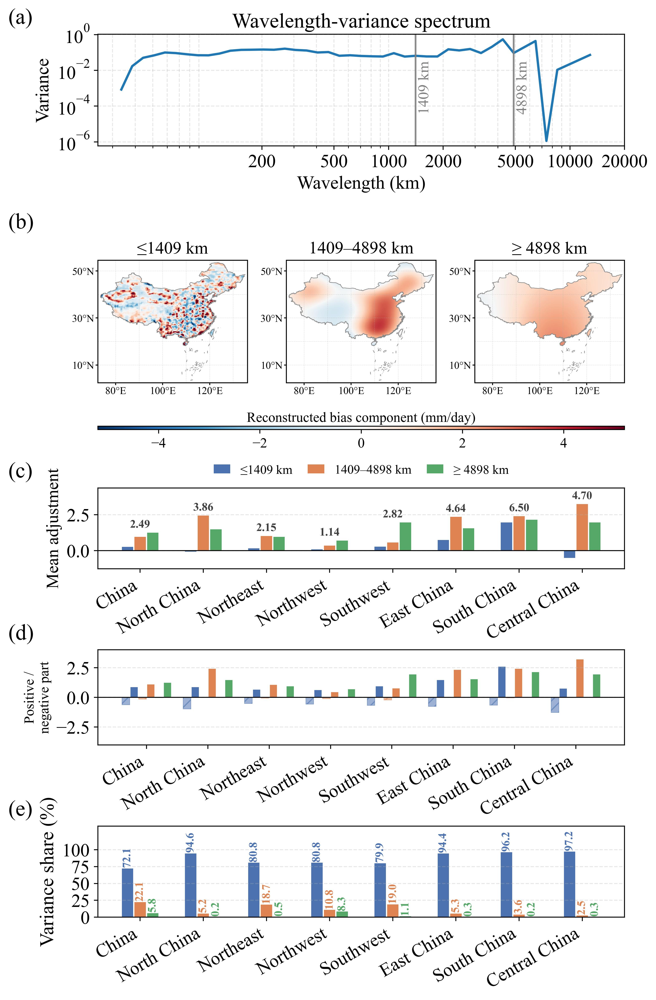

# 图 10 —— 调整场（Bias）的谱分析与尺度分解

图 10 对涌现约束带来的格点调整场 $\text{Bias} = \text{posterior\_mean} - \text{prior\_mean}$（SSP2-4.5、2021–2050）做一次全国域 2D DCT 谱分析与尺度分解，回答两个问题：**校正的空间变率集中在哪个尺度**，以及**哪些尺度上的空间结构被改动得最彻底**。它对应论文第 3.2 节「调整场的尺度分解」，与图 11（不确定性本身的三档缩减率，`Fig11_UncertaintyDecomposition`）互补。成品图共 5 个面板：(a) 波长-方差谱与两个特征尺度断点、(b) 三档带通重构场、(c) 各区域三档净调整量、(d) 各区域各档正值/负值部分、(e) 各区域三档方差份额。**本模块只由一个脚本 `Fig10.py` 构成**：它除出图外，还负责 `data/` 下全部统计表的落盘——先是 `scale_variance.csv`，随后（原独立脚本 `region_stats.py` 于 2026 年合并进来）再写区域 × 三档的格点正负号长表 `region_band_sign_stats.csv`；两段代码共处同一命名空间，掩膜、加权与三档带通场全部直接复用，不再有 `sys.path` + 跨脚本 `import`。

## 目录结构
```
Fig10_BiasScaleDecomposition/
├── Fig10.py         # 唯一脚本：2D DCT 谱分析 → 斜率曲率断点检测 → 三档带通重构 → 5 面板图 + data/ 下全部统计表；随后在同一命名空间内做区域 × 三档的格点正负号补充统计（不出图）
├── Fig10.jpg        # 论文成品图（(a)–(e) 五面板，400 dpi）
├── data/            # 原始数据 + 代码计算的统计数据
│   ├── bias_spectrum.csv           # (a) 谱数据：41 个对数分箱的波长-方差
│   ├── bias_slope.csv              # 谱数据 + 滑动窗口 log–log 局部斜率 log_slope
│   ├── breakpoint.json             # 断点检测全记录（7 个候选、2 个保留）
│   ├── band_1_le1409_km.npy        # (b) 小尺度带通重构场（≤1409 km，163×283 float64）
│   ├── band_2_1409-4898_km.npy     # (b) 中尺度带通重构场（1409–4898 km）
│   ├── band_3_ge_4898_km.npy       # (b) 大尺度带通重构场（≥4898 km，承接零频项）
│   ├── scale_variance.csv          # 逐区域统计权威表：11 个区域 × 三档 ×（方差/均值/绝对值/正负部分/份额）
│   ├── region_band_sign_stats.csv  # Fig10.py 区域统计段输出：11 区域 ×（三档 + total）的正负号长表
│   ├── band_energy.csv             # 【废弃留档】旧口径能量统计，2026-09-21 起不再由脚本产出
│   ├── region_band_shares.csv      # 【废弃留档】旧「逐区域独立 DCT」份额，自 2026-09-21 起不再被读取
│   └── Bielli和Roca - 2010 - Scale decomposition ….pdf   # 方法参考文献原文（原 doc/参考文献/）
└── README.md
```

## 运行
```bash
cd "F:\Program\2Process\4HiCPC\Using hierarchical emergent constraints to reduce the uncertainty in future extreme precipitation projections over China"
python "src/Pic/Fig10_BiasScaleDecomposition/Fig10.py"   # 单条命令复现 Fig10.jpg 与 data/ 下全部统计表
```
依赖：**numpy、pandas、xarray、matplotlib、cartopy、pyshp（`import shapefile`）、shapely、scipy（`scipy.fft.dctn/idctn`）**。合并为单文件后（原 `region_stats.py` 的 `sys.path.insert(0, THIS_DIR)` + `import Fig10 as F` 脚手架已整体删除，`THIS_DIR` 亦不再需要），只需这一套依赖，不再有第二个入口。

脚本用 `Path(__file__).resolve().parents` 自下向上定位仓库根（同时含 `src/` 与 `Doc/`），无需修改路径。

运行须知：

- **一次运行、两步产出、顺序固定**：`main()` 依次做 ① 读 NC 得 Bias → ② 谱分析 + 断点检测 → ③ 三档带通重构（落盘 `data/band_{1,2,3}_*.npy`）→ ④ 区域掩膜（全国 + 七分区 + 三流域）→ ⑤ 逐区域统计 `data/scale_variance.csv` → ⑥ 出 5 面板图 `Fig10.jpg`，**之后**才做 ⑦ 区域正负号补充统计 `data/region_band_sign_stats.csv`——即"先谱/断点、再带通重构；先掩膜、再区域统计"的原始顺序不变。
- ⑦ 直接复用 ⑤ 之前建立的内存对象：`lat`/`lon`/`delta`、三档 `bands`（就是刚落盘的那三份 `.npy`，`np.save`/`np.load` 往返逐比特一致）、`land_mask` 与 `_lat_weights`，因此既不重读 NC、也不重建全国掩膜；原先"两个脚本必须放在同一目录、不能单独拷出"的限制随之消失。
- 路径仍取 `Path(__file__).resolve().parent`（`DATA_DIR = <模块根>/data`、`FIG_DIR = <模块根>`；`REPO_ROOT`/`DATA_ROOT`/`NC_PATH` 由 `parents` 向上定位），脚本留在模块根即可，成品图落盘在模块根目录 `Fig10.jpg`。脚本文件头注释中残留的 `fig/Fig10.jpg` 是扁平化重构前的旧路径。
- **流域掩膜的两处口径差异按原样保留**（合并时未做"统一"）：⑤ 的 `scale_variance.csv` 用 `region_masks` 得到的流域掩膜（不与陆地掩膜取交），⑦ 的 `region_band_sign_stats.csv` 用 `build_river_mask(...) & land_mask`——与原 `Fig10.py` / `region_stats.py` 各自的行为逐一对应。
- **下游依赖**：`Fig11_UncertaintyDecomposition` 的 `Fig11.py`、`尺度谱.py`、`_calc_cross_check.py` 均读取本模块的 `data/breakpoint.json`（`selected_breakpoints` 用作图 11 三档边界，保证图 10／图 11 用同一把尺子）；`data/scale_variance.csv` 是本模块区域统计的权威落盘表，正文与摘要引用的份额数值均出自该表——**改动本模块的断点或口径会直接影响图 11**。

## 数据来源
| 文件 | 来源 / 生成脚本 | 说明 |
|---|---|---|
| `Output/EC/China/HEC_ssp245_PrecipVar_to_R95mm_intensity.nc` | 仓库 `Output/`——pipeline 脚本 6 的规范输出（SSP2-4.5、2021–2050 预估），脚本显式指定该路径，不读 `src/Pic` 下的手工拷贝 | 模块唯一的气象输入。`Fig10.py` 取 `posterior_mean − prior_mean` 作调整场 Bias（合并前 `region_stats.py` 会再 `open_dataset` 读一次同一文件；合并后全程只读一次，区域统计段复用内存中的 `lat`/`lon`/`delta`，数值完全相同）。网格 163×283，覆盖 14.8°–55.2°N、69.8°–140.2°E |
| `Data/China/cnmap.shp` | 仓库 `Data/` 目录 | 中国行政边界（LineString 集合）。经 `shapely.ops.polygonize` + `unary_union`（`.buffer(0)`）合成多边形，用 `shapely.prepared.prep` 加速逐格点 `intersects`，得全国陆地掩膜 |
| `Data/River/HuanghaiRiver_polygon.shp`、`Data/River/PearlRiver_polygon.shp`、`Data/River/YangtzeRiver_polygon.shp` | 仓库 `Data/River/` 目录 | 三个流域多边形掩膜（包围盒预筛 + 逐点 `contains`，与图 4／图 6 同一实现）。**仅写入 CSV，不出图**。注：黄河流域的文件名仍为 `HuanghaiRiver_polygon.shp`，范围是黄河流域 |
| `data/bias_spectrum.csv` | `Fig10.py` | (a) 面板数据：41 行，两列 `wavelength_km`、`variance`；对数分箱（`np.geomspace` 45 箱）内 power 求和，中心波长实测跨 33.5–12906 km |
| `data/bias_slope.csv` | `Fig10.py` | 上一文件的副本加一列 `log_slope`（`window=5` 的滑动窗口 log–log 局部斜率），41 行 |
| `data/breakpoint.json` | `Fig10.py` | `selected_breakpoints = [1408.97, 4897.51]`（km），另有 `selected` 外的 7 个候选断点及其 `change_rate`（曲率）、`n_bins = 41`、`scenario = "ssp245"`。`r2`/`slope_before`/`slope_after` 及每个候选的 `r2`/`slope_left`/`slope_right` 均写为 `null`（当前算法不使用这些量） |
| `data/band_1_le1409_km.npy`、`data/band_2_1409-4898_km.npy`、`data/band_3_ge_4898_km.npy` | `Fig10.py` | (b) 面板的三档带通重构场，均为 163×283 `float64`。文件名中的 `le`/`ge` 与 `-` 由档位标签 `≤1409 km` / `1409–4898 km` / `≥4898 km` 转写而来 |
| `data/scale_variance.csv` | `Fig10.py` | 逐区域统计权威表，**11 行**（全国 + 七分区 + 三流域）**44 列**。三套口径并列：面积加权（`var_s*`/`mean_s*`/`abs_s*`）、未加权（`unw_` 前缀）、正负部分（`pos_s*`/`neg_s*` 为 cos φ 加权平均、`pos_raw_s*`/`neg_raw_s*` 为原始格点求和），另有 `share_s1..3`（方差份额，%，每行合计 100）与 `pos_total`/`neg_total`/`domain_mean`/`n_grid`。图 10(c)(d)(e) 的柱高全部取自本表；流域行因区域平均接近零会放大份额噪声，(c) 面板不出图但 CSV 保留 |
| `data/region_band_sign_stats.csv` | `Fig10.py`（区域统计段，原 `region_stats.py`；合并后同一次运行写出） | 长表 **44 行**（11 个区域 ×（三档 + `total`）行）。列：`n_grid`、`mean`、`pos_part`、`neg_part`、`abs_mean`、`pos_frac_pct`（正格点面积占比）、`pos_amp`、`neg_amp`、`var`、`share_pct`、`residue_pct`（残留比 = \|净值\| / 平均绝对幅值 × 100）。份额分母为三档带通场方差之和（与图 10(c) 一致），不是调整场总方差 |
| `data/band_energy.csv` | **无（废弃留档）** | 8 行（全国 + 七分区）的能量/份额表（`energy_total`、`energy_s1..3`、`share_s1_pct..3`、`meanabs_*`）。属旧口径产物，自 2026-09-21 起不再由 `Fig10.py` 产出，现行脚本也不读取 |
| `data/region_band_shares.csv` | **无（废弃留档）** | 11 行，列 `share_s1..3`、`additivity_err_pct`、`n_cells`。是旧的「逐区域独立 DCT」结果，自 2026-09-21 起本模块脚本不再读取；其数值与现行 `scale_variance.csv` 的 `share_s*` 不同（例如华北 97.22%/2.78%/0.00% 对现行 94.57%/5.21%/0.22%），**引用份额请一律以 `scale_variance.csv` 为准** |

## 产出
| 文件 | 内容 |
|---|---|
| `Fig10.jpg` | 论文成品图，`figsize=(7.874, 11.6)` in、400 dpi、`bbox_inches="tight"`，6 行网格 `height_ratios=[5.4, 2.3, 0.16, 3.9, 4.6, 4.4]`。面板：(a) 波长-方差谱（双对数，标出 1409/4898 km 两条竖线）；(b) 三张带通重构场（共用对称发散色标 `RdBu_r`，±99 分位数取整，间距 `wspace=0.26`，每张小图各自带经纬度刻度）；(c) 各区域三档净调整量分组柱（柱顶数字为三档之和，即该区域平均调整量）；(d) 各区域各档正值/负值部分（每区域 6 根柱，实色=正、同色斜线=负）；(e) 各区域三档方差份额（%，每区域合计 100，柱顶竖排数值） |
| `data/bias_spectrum.csv`、`data/bias_slope.csv` | (a) 面板的可复现谱数据与局部斜率（41 行） |
| `data/breakpoint.json` | 断点检测结果，**图 11 的三档边界由此读取** |
| `data/band_{1,2,3}_*.npy` | 三档带通重构场（163×283 `float64`），三档严格可加 |
| `data/scale_variance.csv` | 逐区域三套口径统计 + 方差份额，(c)(d)(e) 面板与正文／摘要数值的唯一来源 |
| `data/region_band_sign_stats.csv` | 区域 × 三档的正负号构成（正格点占比、正/负振幅、残留比），供区域专项分析引用 |

## 代码说明
| 脚本 | 作用 | 主要产出 |
|---|---|---|
| `Fig10.py`（**本模块唯一脚本**，2026 年由原 `Fig10.py` + `region_stats.py` 两文件合并而成，`main()` 一次跑完两段） | **第一段（出图）**：读 NC 得 Bias 场 → `compute_spectrum` 做 2D DCT 波长-方差谱（45 个对数箱）→ `sliding_slope`（`window=5`）算局部斜率 → `detect_breakpoints`（二阶差分峰值，阈值 1.0）→ `select_breakpoints` 剔除网格尺度（< 200 km）与聚类冗余（Δlog₁₀λ < 0.4）→ `dct_filter_bands` 按保留的前 2 个断点做带通重构 → 全国一次 DCT、各子区域按掩膜裁剪统计（`_wmean`/`_wmean_abs`/`_wvar`，cos φ 面积加权）→ 出 5 面板图。**第二段（区域统计，不重画图）**：`sign_stats()` / `region_sign_stats()` 做 `scale_variance.csv` 未覆盖的区域统计——对每个（带通场, 区域）算净值、正/负部分、平均绝对幅值、正格点面积占比、正/负格点平均振幅、方差，并派生 `share_pct`（三档归一）与 `residue_pct`（残留比 = \|有符号区域平均\| / 面积加权平均绝对幅值，残留比 4% 即 96% 相消）；掩膜（`region_masks` / `build_river_mask`）、cos φ 加权（`_lat_weights`）与三档带通场（内存中的 `bands`）全部直接复用第一段，不再跨脚本 `import`，档位显示名改用模块常量 `SIGN_BAND_LABELS` | `Fig10.jpg`、`data/bias_spectrum.csv`、`data/bias_slope.csv`、`data/breakpoint.json`、`data/band_{1,2,3}_*.npy`、`data/scale_variance.csv`、`data/region_band_sign_stats.csv`；终端另打印华北三档明细与小尺度档残留比排序 |

## 方法说明

以下内容合并自原 `doc/Methodology.md`（18.7 KB）与 `doc/华北_图10分析.md`（12.6 KB）——`doc/` 目录已随扁平化重构删除。为符合现行目录，原文中的 `code/Fig10.py`、`code/region_stats.py` 一律写作 `Fig10.py`、`region_stats.py`（后者现已并入 `Fig10.py`，本 README 中凡提及它处均注明为"区域统计段"），图片引用 `../fig/Fig10.jpg` 写作 `Fig10.jpg`；其余文字、数字、公式与表格均按原文保留。

### 口径变更提示（原 Methodology 文首三条注记）

> **口径变更提示（2026-10-09）**：本文档写于 2026-09-21–23，其中的数值为**当时**的口径（断点曾取 200 km / 1409 km，且 Bias 场扣除了全域均值；正文引用的"中-α 尺度方差占比全国 59.5%、大尺度 32.1%、超长波 8.4%"即出自该版本）。当前口径已改为：断点 **1409 km / 4898 km**、**不扣除**全域均值、三档名称为小尺度（≤1409 km）／中尺度（1409–4898 km）／大尺度（≥4898 km）；现行数字以 `data/scale_variance.csv` 为准（`data/uncertainty_decomposition.csv` 为 2026-10-09 之前的旧产物，当前工作区已不存在，本模块 `data/` 内亦无此文件）——调整场空间变率份额全国 72.1%/22.1%/5.8%，净调整量全国 0.27/0.96/1.25 mm/day。文中的推导与方法本身仍然有效，仅数值需按新口径重读。

> **数据列补充（2026-10-11）**：`data/scale_variance.csv` 新增 `share_s1`/`share_s2`/`share_s3` 三列，即 (c) 面板的方差份额（%，每行三列合计 100），由同表 `var_s1..3` 归一化得到；正文与摘要引用的份额（全国 72.1%/22.1%/5.8%，华北 94.6%、华东 94.4%、华中 97.2%、华南 96.2%，西南中尺度 19.0%、东北中尺度 18.7%、西北大尺度 8.3%）可直接查表，不必再手算。(d) 面板的正值/负值部分沿用同表的 `pos_s1..3` / `neg_s1..3`（cos φ 面积加权平均，mm/day；原始格点求和另存 `pos_raw_s*` / `neg_raw_s*`）；某尺度两根柱的代数和即该尺度的 `mean_s*`，六根柱之和即该区域的 `total_mean`。加列后重跑 `Fig10.py`，`Fig10.jpg` 与其余 data 文件逐字节不变（Fig10.jpg SHA-256 `5F2159A6…BD48`），仅该 CSV 多出上述三列。

> **区域专项分析（2026-10-11）**：新增 `华北_图10分析.md`（已并入本 README）——以华北（110–118°E、35–42°N ∩ 陆地，950 格点）为例逐面板解读图 10：净调整量 +3.856 mm/day 由中尺度（+2.443）与大尺度（+1.488）承担，方差份额 94.6%/5.2%/0.2%，小尺度正值 +0.889 与负值 −0.964 几乎完全相消（净值仅占平均绝对幅值的 4.0%，八个统计单元中最彻底），且强正/强负格点分别集中在太行山中段东麓与北段西侧。该分析另需"格点正号占比、正/负振幅、平均绝对幅值、残留比"四类量，由 `Fig10.py` 的区域统计段（`sign_stats()` / `region_sign_stats()`；原为独立脚本 `region_stats.py`，2026 年已合并进 `Fig10.py`，`main()` 一次运行即写出）从 `data/band_*.npy` + 掩膜复算并写入 **`data/region_band_sign_stats.csv`**（全国 + 七分区 + 三流域 × 三档 + total 行，44 行；已加入 `.gitignore` 放行清单）。这一统计段只做统计、不出图，不影响 `Fig10.jpg`。

### 一、基于二维 DCT 的谱分析

#### 1.1 离散余弦变换

对于定义在 $N_y \times N_x$ 网格上的二维场 $f(x, y)$，我们使用正交归一化的 Type-II DCT：

$$F(k_x, k_y) = \text{DCT-II}\{f(x,y)\} = \sum_{x=0}^{N_x-1} \sum_{y=0}^{N_y-1} f(x,y) \, \alpha(k_x) \, \alpha(k_y) \cos\left[\frac{\pi k_x}{N_x}(x+\tfrac12)\right] \cos\left[\frac{\pi k_y}{N_y}(y+\tfrac12)\right]$$

其中 $\alpha(0) = \sqrt{1/N}$，$\alpha(k>0) = \sqrt{2/N}$。在此归一化下，Parseval 定理成立：

$$\sum_{x,y} f(x,y)^2 = \sum_{k_x,k_y} F(k_x,k_y)^2$$

场的方差可写为各谱模方差贡献之和：

$$\text{Var}(f) = \frac{1}{N_x N_y} \sum_{k_x,k_y} F(k_x,k_y)^2 = \sum_{k_x,k_y} P(k_x,k_y)$$

其中 $P(k_x,k_y) = F(k_x,k_y)^2 / (N_x N_y)$ 为每个谱模的方差贡献。选择 DCT 而非 DFT 是因为其隐含的对称延拓避免了傅里叶变换在有限区域边界处的人为跳跃伪影。

#### 1.2 波长映射

每个 DCT 模式 $(k_x, k_y)$ 对应一个物理波长，由 DCT 等效波数导出：

$$\lambda(k_x, k_y) = \left[ (k_x / L_x)^2 + (k_y / L_y)^2 \right]^{-1/2}$$

其中 $L_x$、$L_y$ 分别为 $x$、$y$ 方向的空间域长度：

$$L_x = \Delta x \cdot (N_x - 1), \quad L_y = \Delta y \cdot (N_y - 1)$$

格点间距 $(\Delta x, \Delta y)$ 由地理坐标计算：

$$\Delta y = \frac{\pi}{180} \, \overline{|\Delta \text{lat}|} \cdot R_\oplus$$

$$\Delta x = \frac{\pi}{180} \, \overline{|\Delta \text{lon}|} \cdot R_\oplus \cdot \overline{\cos(\text{lat})}$$

其中 $R_\oplus = 6371$ km 为地球平均半径。$(0,0)$ 模式（DC 分量）代表区域均值，赋值为 $\lambda = \infty$。

#### 1.3 方差谱（方差保持谱）

为获得各尺度方差贡献的可比较估计，DCT 模式按波长以对数均匀分箱（通常 45 箱，范围 $[0.9 \cdot \lambda_{\min},\; 1.1 \cdot \lambda_{\max}]$）进行分组。每个分箱内的方差为该箱内所有模式方差贡献之和：

$$V(\lambda_i) = \sum_{j \in \text{bin}_i} P_j$$

由于对数均匀分箱的宽度随波长等比例增长，长波段分箱自然包含更多模式并累积更多方差贡献。在此表示下，全波段方差之和等于原始场的总方差：

$$\sum_i V(\lambda_i) = \text{Var}(f)$$

该谱称为方差保持谱（Variance-preserving spectrum），曲线下面积在对数-线性坐标下正比于总方差，能够直观地反映哪个尺度段贡献的方差最大。在对数-对数坐标系下绘制时，方差谱中幂律关系的斜率可使用断点检测方法识别。

#### 1.4 局部斜率

使用滑动窗口（默认 $w=5$ 个分箱）估计对数-对数空间的局部斜率。对以第 $i$ 个分箱为中心的窗口进行线性回归：

$$\ln V(\lambda) = m_i \ln \lambda + c_i$$

得到尺度 $\lambda_i$ 处的局部谱指数 $m_i = d(\ln V) / d(\ln \lambda)$，该值反映了该尺度附近方差随波长的衰减速率。

---

### 二、基于斜率曲率的断点检测

#### 2.1 曲率定义

在滑动斜率 $m(\lambda)$ 的基础上，计算其对 $\ln \lambda$ 的二阶导数绝对值作为曲率：

$$\text{curvature}(\lambda_i) = \left| \frac{d^2 m}{d (\ln \lambda)^2} \right|$$

曲率峰值对应局部斜率发生急剧变化的位置，即为特征尺度转变的候选断点。

#### 2.2 峰值检测与筛选

对曲率序列进行峰值检测：识别局部极大值点（$d^2 m / d(\ln \lambda)^2$ 大于两侧邻点且超过给定阈值）。曲率阈值默认设为 $1.0$，低于该值的微小波动视为噪声滤除。

检测得到的峰值集合 $\{(\lambda_p, c_p)\}$ 按曲率值降序排列，代表谱斜率变化剧烈程度由高到低的候选断点。

#### 2.3 断点选取与去冗余

为获得适用于尺度分解的断点集，对候选峰值进行以下筛选：

1. 最小波长过滤：排除波长 $< 200$ km 的峰值（低于该阈值的断点接近网格分辨率，物理意义有限）。
2. 最小对数间距约束：按曲率降序依次选取，要求新选取的断点与已选断点的对数波长间距 $\geq 0.4$，避免断点过于集中导致分解波段失衡。

经筛选后取前 2 个断点作为最终的特征尺度。

---

### 三、基于 DCT 滤波的尺度分解

#### 3.1 DCT 域带通滤波

给定一组排序后的 $N_b$ 个断点 $\{\lambda_1^*, \lambda_2^*, \ldots\}$，谱域被划分为 $N_b + 1$ 个尺度波段。每个波段通过对 DCT 系数施加掩膜进行重构：

$$\text{波段 } b: \quad \tilde{F}_b(k_x, k_y) = F(k_x, k_y) \cdot \mathbb{1}\{\lambda_b^\text{min} \leq \lambda(k_x, k_y) < \lambda_b^\text{max}\}$$

其中各波段波长限定义为：

$$\lambda_b^\text{min} = \lambda_{b-1}^* \; (\text{或 } 0, \, b=1), \qquad \lambda_b^\text{max} = \lambda_b^* \; (\text{或 } \infty, \, b=N_b+1)$$

此掩膜等价于理想带通滤波器（陡峭截止），保留选定波长范围内的所有功率，完全移除其他尺度的贡献。与高斯或 Butterworth 滤波器相比，理想滤波在谱空间中具有最小的模态泄漏，便于对各尺度段进行精确的方差分解。

#### 3.2 逆 DCT

每个波段的滤波系数场通过逆 DCT 变换回物理空间：

$$\tilde{f}_b(x, y) = \text{IDCT-II}\{\tilde{F}_b(k_x, k_y)\}$$

由于正交归一化 DCT-II 是正交变换，IDCT 即为其逆变换。重构场 $\tilde{f}_b$ 描述了 Bias 场在第 $b$ 个尺度区间内的空间分布模式。

基于 Parseval 定理和掩膜的互不相交支持，全场总方差严格等于各波段方差之和：

$$\text{Var}(f) = \sum_{b=1}^{N_b+1} \text{Var}(\tilde{f}_b)$$

该正交性在全局域上严格成立，但在子区域掩膜内会被破坏。

---

### 四、区域尺度贡献度分析

#### 4.1 区域定义

构建两类空间掩膜：

- 全国：基于中国行政边界 Shapefile（`cnmap.shp`）的陆地掩膜。该 Shapefile 由 LineString 边界线段组成，通过 `shapely.ops.polygonize` 将其转换为多边形并合并为统一的 MultiPolygon。使用 `shapely.prepared.prep` 加速空间查询，对格网点逐一进行 `intersects` 判断。

- 七个子区域：华北、东北、西北、西南、华东、华南、华中，以经纬度矩形框定义：

  $$\mathcal{M}_r(\text{lat}, \text{lon}) = \mathbb{1}\{\text{lon}_\text{min} \leq \text{lon} \leq \text{lon}_\text{max}\} \cdot \mathbb{1}\{\text{lat}_\text{min} \leq \text{lat} \leq \text{lat}_\text{max}\}$$

  各子区域掩膜与全国陆地掩膜取交，以排除海域格点。

#### 4.2 方差贡献度计算

> 空间方差的定义：对一个二维场 $f$ 在空间掩膜 $\mathcal{M}$ 内（包含 $N$ 个格点），空间方差定义为 $\sigma^2 = \frac{1}{N} \sum_{(i,j)\in\mathcal{M}} (f(i,j) - \bar{f})^2$，其中 $\bar{f}$ 为该区域内 $f$ 的空间平均值。它衡量的是场在空间维度上的离散程度——值越大表示该区域内格点间的数值差异越大，值越小表示场的数值在空间上越一致。这与模式集合成员间的集合方差（同一格点不同成员的离散度）是两个不同的概念。

对每个掩膜 $\mathcal{M}_r$ 和每个重构波段场 $\tilde{f}_b$，计算区域内空间方差：

$$\sigma_{r,b}^2 = \text{Var}\left( \tilde{f}_b \;|\; \mathcal{M}_r \right) = \frac{1}{N_r} \sum_{(i,j) \in \mathcal{M}_r} \left( \tilde{f}_b(i,j) - \bar{\tilde{f}}_b \right)^2$$

其中 $N_r$ 为掩膜 $\mathcal{M}_r$ 内的格点数，$\bar{\tilde{f}}_b$ 为 $\tilde{f}_b$ 在该区域的空间均值。

第 $b$ 个尺度区间在区域 $r$ 中的方差占比为：

$$\phi_{r,b} = \frac{\sigma_{r,b}^2}{\sum_{k=1}^{N_b+1} \sigma_{r,k}^2}$$

该值反映了各个尺度区间在区域内的相对贡献，取值范围为 $[0, 1]$，同一区域内各波段占比之和恒为 1。这使得我们可以直接进行跨区域和跨尺度的比较——例如，某区域在中-α 尺度（200–1409 km）的占比显著高于全国平均，则暗示该区域的 Bias 场主要受该尺度过程控制。

---

### 五、Bias 场的波长-方差谱（结果）

#### 5.1 Bias 场的含义与谱特征

Bias 场定义为后验均值减去先验均值：$\text{Bias} = \text{posterior\_mean} - \text{prior\_mean}$。当 Bias $> 0$ 时，表示涌现约束校正后降水极端指数（R95mm 强度）较原始多模式均值增大，即原始模式低估了该值；当 Bias $< 0$ 时，表示校正后值减小，即原始模式高估了该值。Bias 的绝对值大小反映了约束对该格点校正的强度。

对 SSP2-4.5 场景下的 Bias 场（维度 163$\times$283，覆盖 14.8°–55.2°N、69.8°–140.2°E）进行 2D DCT 谱分析。对数分箱后获 41 个有效谱点，波长范围约 50–9000 km（`data/bias_spectrum.csv` 实测分箱中心波长跨 33.5–12906 km）。方差谱在对数-对数坐标下呈分段幂律结构（图 10a）。

通过斜率曲率检测获得 7 个候选断点（阈值 $> 1.0$），经筛选：

- 网格尺度过滤（$< 200$ km）：排除 51、77 km
- 对数间距过滤（$\Delta\log\lambda \geq 0.4$）：排除 2134、3233、8520 km

获最终断点：

$$\lambda_1^* = 1409\ \text{km}, \quad \lambda_2^* = 4898\ \text{km}$$

1409 km 与文献报道的降水谱~1400 km 转变尺度一致；4898 km 对应大尺度端方差谱的急剧衰减（曲率 17.7，所有候选中最强），反映有限区域边界的谱约束。



> 落盘值以 `data/breakpoint.json` 为准：`selected_breakpoints = [1408.973115441372, 4897.510856410296]` km，二者 `change_rate` 分别为 2.2656 与 17.2864；7 个候选断点依次为 50.82、76.98、1408.97、2134.32、3233.09、4897.51、8520.25 km（`change_rate` 2.922 / 1.123 / 2.266 / 1.563 / 3.777 / 17.286 / 8.105）。

#### 5.2 尺度分段

两个断点将谱域划分为三个波段（分解统一取 200 km 为波长下界，200 km 以下接近 0.25° 网格可分辨上限，作为网格尺度噪声从分解中剔除）：中-α 尺度（200–1409 km）、大尺度（1409–4898 km）、超长波（≥4898 km）。三档名称与波长区间在全文中统一使用。

> 现行口径已统一为：小尺度（≤1409 km，**含 200 km 以下的网格尺度分量**）、中尺度（1409–4898 km）、大尺度（≥4898 km，承接零频项）；200 km 只是断点识别时的剔除阈值，不是分解下界。

---

### 六、核心问题分析

#### 6.1 问题一：校正主要发生在哪个尺度？

Bias（posterior − prior）的空间方差在哪个尺度段最集中？

对 Bias 场按上述波段进行 DCT 滤波重构，计算各区域内各波段的方差占比，结果见图 10c。

结论：校正的空间变率主要集中在中-α 尺度（200–1409 km）。 约束校正对各区域空间变率的尺度贡献度如下：全国范围内中-α 尺度贡献度为 59.5%，大尺度为 32.1%，超长波为 8.4%。区域差异显著：东部各子区域（华北 91.7%、华东 88.1%、华南 90.9%、华中 95.0%）的中-α 尺度份额超过 88%，其中华中最高达 95.0%；大尺度份额以长江流域（41.7%）、西南（28.9%）与黄河（28.4%）最为突出；超长波仅在西北有显著贡献（10.3%）。华南总校正量最高（三波段平均绝对值之和 6.55 mm/day），中-α 尺度份额为 90.9%，与该区域受季风和热带系统影响的强空间变率一致。


> 本节数值属 2026-10-09 之前的旧口径（断点 200/1409 km、且扣除全域均值）；按现行口径（断点 1409/4898 km、不扣全域均值）重算后的份额为全国 72.1%/22.1%/5.8%，见 `data/scale_variance.csv` 的 `share_s1..3`。

---

#### 6.2 问题二：校正在哪个尺度作用最大？

仅看 Bias 的绝对方差分布（问题一）只能回答"校正量的多少"，但无法区分：该尺度上较大的 Bias 方差是因为约束主动改变了空间结构，还是因为 prior 本身在该尺度上就有很大的空间方差——校正只是"顺势而为"。

为消除 prior 背景方差的尺度差异，将校正的相对幅度定义为 Bias 方差占 Prior 方差的比例：

$$\text{相对校正幅度}_{r,b} = \frac{\sigma_{r,b}^{2,\text{Bias}}}{\sigma_{r,b}^{2,\text{prior}}}$$

该比值衡量的是约束对 prior 场原有空间结构的修改比例——比值越高，说明相对于该尺度上 prior 固有的空间变率，约束施加的调整越显著，即"校正的作用越大"。

举例说明：若某区域 prior 方差很大，即使 Bias 方差绝对值不小，相对比例可能仍然不高，说明约束只是小幅调整了一个本身变率很大的场；反之，若 prior 方差很小而 Bias 方差与之相当，则说明约束从根本上改变了该尺度的空间格局。

结论：绝对校正量集中在中-α 尺度（200–1409 km），但相对校正幅度最大的却是大尺度（1409–4898 km）。 按 Bias 方差占比，全国范围内中-α 尺度为 59.5%、大尺度为 32.1%、超长波为 8.4%；而按"Bias 方差 / 同波段 prior 方差"衡量，全国平均相对校正幅度为大尺度 23.7%、超长波 21.9%、中-α 尺度 11.6%——中-α 尺度反而最小，大尺度最大。这一反差说明：中-α 尺度贡献的 Bias 方差最多，主要是因为它本身就是 prior 空间方差最大的波段，约束在该尺度上更多是"顺势而为"；而大尺度上 prior 固有的空间变率相对较小，约束却施加了比例最大的调整，即 prior 原有的空间结构在大尺度上被改动得最彻底。三个波段的相对校正幅度都落在 10%–25% 区间，表明约束对各尺度 prior 的空间结构都有实质性修改，只是侧重不同。

---

### 七、综合讨论

#### 7.1 涌现约束在哪个尺度起作用？

结合两个问题的答案：校正（均值偏移）的绝对量集中在中-α 尺度（200–1409 km），该尺度对全国范围 Bias 方差的贡献度为 59.5%；但相对校正幅度最大的却是大尺度（1409–4898 km），全国平均 Bias/prior 为 23.7%，超长波为 21.9%，中-α 尺度反而最小（11.6%）。

涌现约束对降水预估的修正同时体现在中-α 尺度的绝对校正量和大尺度的相对结构调整上。中-α 尺度对应锋面、气旋、季风槽等天气系统和地形强迫过程——正是一般环流模式（GCM）在这些可分辨尺度上系统性偏差最大的地方，也是观测约束信息最为丰富的波长区间，因此贡献了全国 Bias 方差的 59.5%。但就"Bias 方差 / 同波段 prior 方差"而言，大尺度（1409–4898 km）的相对校正幅度最高（23.7%），说明该尺度上 prior 原有的空间结构被改动得最彻底；中-α 尺度之所以贡献的 Bias 方差最多，是因为 prior 本身在该尺度上的空间方差就最大。

从不确定性的角度看，图 11 给出的全国平均 σ 降低率为中-α 尺度 11.3%、大尺度 10.3%、超长波 11.1%，三个波段几乎一致，没有明显的尺度选择性；逐格点区域的 σ 缩减率则在 15%–28% 之间。

涌现约束本质上是一种"格点级"的修正——它利用每个格点上观测与模式变量的统计关系进行独立调整，因此其绝对校正量主要落在中-α 尺度上，而对大尺度 prior 空间结构的改动比例最大。

#### 7.2 其他尺度需要用其他什么方法解决？

大尺度（1409–4898 km）：Bias 方差占比 32.1%（全国），在三个波段中位居第二；但其相对校正幅度最高（23.7%），说明该尺度上 prior 原有的空间结构被改动得最彻底。这些尺度对应东西向环流、遥相关型等大尺度动力过程，其偏差往往源于模式物理参数化的系统性缺陷（如对流参数化对 Walker 环流的响应偏差）。这些问题可能需要多模式物理参数化扰动或超级集合方法来解决，而非单纯依靠观测统计约束。

超长波（≥ 4898 km）：Bias 方差占比 8.4%（全国），在三个波段中最低，在西北可达 10.3%，反映的是大陆尺度的一致性偏差；其相对校正幅度为 21.9%。这类偏差通常源于模式对全球辐射强迫或海温梯度等大尺度边界条件的响应误差，绝对校正量最小，单靠涌现约束难以充分纠正。建议采用区域气候模式（RCM）动力降尺度或贝叶斯模型平均（BMA） 等方法，从物理机制层面校正模式在大尺度背景态上的系统性偏移。

汇总而言，中-α 尺度（200–1409 km） 的 Bias 方差占比最高（59.5%），涌现约束贡献的绝对校正量集中于此，可配合统计降尺度；大尺度（1409–4898 km） Bias 方差占比 32.1%、相对校正幅度最高（23.7%），prior 原有的空间结构被改动得最彻底，其系统性偏差建议使用多模式物理参数化扰动或超级集合方法；超长波（≥ 4898 km） Bias 方差占比最低（8.4%）、相对校正幅度 21.9%，建议采用 RCM 动力降尺度或贝叶斯模型平均。

---

### 八、华北地区图 10 专项分析：结论摘要

> 区域：华北 = 110–118°E、35–42°N ∩ 中国陆地（与图 4／图 5／图 6 的分区体系一致），0.25° 网格，共 **950** 个格点，其中 **921** 个（96.9%）通过有效格点判据（p < 0.05 且 r ≥ 0.5）。分解对象：Bias = Posterior − Prior（HEC 后验均值 − 先验均值），三档 = 小尺度 ≤1409 km、中尺度 1409–4898 km、大尺度 ≥4898 km；不扣除全域均值，三档严格可加。数据来源见文末「数据与复现」小节（`data/scale_variance.csv`、`data/region_band_sign_stats.csv`）。

1. **净调整量由中、大尺度承担**：华北平均调整量 **+3.856 mm/day**（全国 +2.486，七个分区中第 4 高），其中中尺度 **+2.443**（占 63.4%）、大尺度 **+1.488**（38.6%），小尺度只有 **−0.075**（−1.9%）。
2. **空间变率几乎全部落在小尺度**：三档方差份额 **94.6% / 5.2% / 0.2%**，即华北的调整场在空间上"长什么样"基本由 ≤1409 km 的结构决定。
3. **小尺度上正、负贡献几乎完全相消**：正值部分 **+0.889**、负值部分 **−0.964 mm/day**，净值仅为平均绝对幅值（1.853 mm/day）的 **4.0%**——八个统计单元（全国 + 七个分区）中相消最彻底的一个；中尺度与大尺度的负值部分为 **0**，是纯粹的单向区域平移。
4. **相消不是随机的，而是有地形组织的**：小尺度最强正调整集中在 **太行山中段东麓**（114.25–114.75°E、37.0–37.25°N，单格点最大 +10.8 mm/day），最强负调整集中在 **太行山北段西侧**（113.5–113.75°E、38.5–39.25°N，−5.4 ~ −6.1 mm/day）；按经度分带，113.5°E 以西小尺度净值为 **−0.892**（正格点仅 27.4%），以东为 **+0.535**（53.3%）。这与图 9 给出的"太行山迎风坡正向调整、背风坡负向调整"在尺度分解下可以定量对上。

### 九、华北案例：图 10(a) 沿用的域级谱结构

谱分析与断点识别在**整个计算域**上做一次（全国计算域一次 2D DCT，各区域自带通结果按掩膜裁剪统计），因此华北与其它区域共用同一套断点：

- 对数分箱后 41 个有效谱点，波长约 34–12900 km，方差谱呈分段幂律；
- 由斜率二阶差分（阈值 1.0）得 7 个候选断点 → 剔除 < 200 km（网格尺度）与 Δlog₁₀λ < 0.4（聚类冗余）→ 保留 **1409 km**（曲率 2.27）与 **4898 km**（曲率 17.29，全谱最强）；
- 1409 km 与既有降水谱研究给出的约 1400 km 转变尺度一致（Bielli & Roca, 2010）。

**为什么华北不单独做断点检测**：区域级单独做 DCT／断点会使各区波段边界不同、份额不可比；统一断点后，"华北的份额 94.6%"与"华南的 96.2%"才是同一把尺子量出来的。华北自身谱形是否存在区域特有的次一级转折（例如 500 km 附近的局地尺度），本图不作回答，需要时可另做。

### 十、华北案例：图 10(b) 三档重构场的量级

| 分量 | 区域平均（净值） | 正值部分 | 负值部分 | 平均绝对幅值 | 正格点面积占比 | 正格点平均振幅 | 负格点平均振幅 | 方差 (mm/day)² |
|---|---|---|---|---|---|---|---|---|
| 小尺度 ≤1409 km | **−0.075** | +0.889 | −0.964 | 1.853 | 42.2% | +2.104 | −1.669 | 6.144 |
| 中尺度 1409–4898 km | **+2.443** | +2.443 | 0.000 | 2.443 | 100% | +2.443 | — | 0.339 |
| 大尺度 ≥4898 km | **+1.488** | +1.488 | 0.000 | 1.488 | 100% | +1.488 | — | 0.014 |
| 全场 Bias | **+3.856** | +3.874 | −0.018 | 3.893 | 98.4% | +3.936 | −1.161 | 6.625 |

（加和自洽：−0.075 + 2.443 + 1.488 = 3.856，与全场平均调整量一致；正值部分合计 +4.820、负值部分合计 −0.964，代数和同为 3.856。注意"各档正值部分之和"≠"全场的正值部分"：前者先把各档取正再相加，后者先把三档相加再取正。）

读法：

- **中尺度 +2.443 mm/day 是华北净调整的主体**，且 100% 的格点为正——这是一次区域尺度的整体抬升，不含局地反向调整；
- **大尺度 +1.488 mm/day 中约 1.25 是全国共同的那份正向调整**（全国大尺度档 1.252 mm/day，因分解未扣全域均值，零频项归入最大尺度段），华北在此之上只多出约 0.24 mm/day；
- **小尺度是唯一"有正有负"的档**：42.2% 的格点为正、57.8% 为负，正格点振幅（+2.10）大于负格点（−1.67），两者相抵后净值只有 −0.075 mm/day。

**华北内部的东西差异远大于南北差异**（面积加权，小尺度档）：

| 分带 | 格点数 | 小尺度净值 | 正格点占比 | 全场净值 |
|---|---|---|---|---|
| 110–113.5°E（太行山以西：山西高原） | 406 | **−0.892** | 27.4% | +2.944 |
| 113.5–118°E（太行山东麓—华北平原） | 544 | **+0.535** | 53.3% | +4.537 |
| 35–38.5°N（南部，华北平原为主） | 460 | −0.177 | 40.7% | +4.273 |
| 38.5–42°N（北部，坝上／内蒙古高原南缘） | 490 | +0.027 | 43.8% | +3.445 |

即：**小尺度调整在 113.5°E 两侧反号**（西负东正），全场调整量也是东侧（+4.54）明显大于西侧（+2.94）；南北向差异则不到 0.2 mm/day。

**极值格点（小尺度档，仅作定性判读）**：最强 6 个正调整格点为 +10.76（114.50°E, 37.25°N）、+10.28（114.75, 37.25）、+9.68（114.75, 37.00）、+9.60（117.25, 36.75）、+9.45（114.50, 37.00）、+8.92（114.25, 37.00）——其中五个集中在**河北省邢台一带（37.0–37.25°N）的太行山中段东麓**；最强负调整格点为 −6.57（116.75, 36.25，鲁中山区西侧）、−6.13（113.75, 39.25）、−6.00（113.50, 38.50）、−5.77（113.50, 39.25）、−5.51（113.75, 38.75）、−5.43（113.75, 39.00）——后五个集中在**太行山北段西侧（忻州—五台山一带）**。

### 十一、华北案例：图 10(c) 方差份额

华北三档方差份额 **94.6% / 5.2% / 0.2%**。与其它统计单元对照：

| 统计单元 | 小尺度份额 | 中尺度份额 | 大尺度份额 |
|---|---|---|---|
| 全国 | 72.1% | 22.1% | 5.8% |
| **华北** | **94.6%** | **5.2%** | **0.2%** |
| 华中 | 97.2% | 2.5% | 0.3% |
| 华南 | 96.2% | 3.6% | 0.2% |
| 华东 | 94.4% | 5.3% | 0.3% |
| 东北 | 80.8% | 18.7% | 0.5% |
| 西北 | 80.8% | 10.8% | 8.3% |
| 西南 | 79.9% | 19.0% | 1.1% |

华北的小尺度份额在七个分区中排第 3（低于华中、华南），且**大尺度份额只有 0.2%**，是七个分区中第二低（仅高于华南的 0.17%）；作为对比，西北的大尺度份额 8.3% 是唯一"有大尺度可辨结构"的区域。含义：**华北调整场的空间变率里，中尺度与大尺度合计只占 5.4%**，讨论华北的调整格局实际上就是在讨论 ≤1409 km 的小尺度结构。

> **份额的口径**：这里的份额 = `var_b / Σ_b var_b`（图 10c 的柱高，分母是**三档带通场方差之和**，不是调整场总方差）。原因是 2D DCT 的基函数只在整块矩形计算域上严格正交，落到掩膜子区域并按 cos φ 加权后带间交叉项不再为零（全国约为总方差的 10%，华南为 −23%），因此 Var(f₁+f₂+f₃) ≠ Σ Var(f_b)；若改用总方差作分母，华东、华南、华中的小尺度份额会超过 100%。华北的交叉项只占总方差的 1.9%，两种分母差别不大（94.6% 对 92.7%），但全文统一采用三档归一。

### 十二、华北案例：图 10(d) 正向与负向贡献

| 分量 | 正值部分 | 负值部分 | 代数和（=净值） | 残留比 \|净值\|/平均绝对幅值 |
|---|---|---|---|---|
| 小尺度 | +0.889 | −0.964 | **−0.075** | **4.0%**（即 96% 相消） |
| 中尺度 | +2.443 | 0.000 | +2.443 | 100%（纯单向） |
| 大尺度 | +1.488 | 0.000 | +1.488 | 100%（纯单向） |
| 合计 | +4.820 | −0.964 | +3.856 | — |

华北是八个统计单元中**小尺度相消最彻底**的一个：

| 统计单元 | 小尺度净值 | 平均绝对幅值 | 残留比 |
|---|---|---|---|
| 华北 | −0.075 | 1.853 | **4.0%** |
| 西北 | +0.090 | 1.204 | 7.4% |
| 东北 | +0.168 | 1.190 | 14.1% |
| 西南 | +0.284 | 1.628 | 17.4% |
| 全国 | +0.270 | 1.508 | 17.9% |
| 华中 | −0.508 | 2.034 | 25.0% |
| 华东 | +0.736 | 2.252 | 32.7% |
| 华南 | +1.958 | 3.267 | 59.9% |

（黄河流域 2.2%、长江流域 2.5% 的残留比更低，但那是流域多边形、区域平均本身接近零，不是同一可比的统计单元。）华北与华中是七个分区中**小尺度净值为负**的两个；华北的中尺度、大尺度负值部分严格为 0，说明这两个尺度上不存在"一边抬升、一边压低"的局地结构。

### 十三、华北案例：与图 9、图 11 的衔接

- **图 9（地形）**：图 9 给出的太行山"迎风坡正向调整、背风坡负向调整"在本图 (b)(d) 的小尺度档上被定量复现——东麓强正（+0.535 区域平均、单点 +10.8 mm/day）、山西高原侧强负（−0.892、单点 −6.1 mm/day）。尺度分解因此给出了这条结论的尺度归属：**它是小尺度现象，既不影响华北净调整量的量级（被相消掉），也不进入中、大尺度的整体平移**。
- **图 11（不确定性）**：华北有效格点（p < 0.05 且 r ≥ 0.5）上，面积加权的模式间相关系数 r = **0.778**，先验 σ = **2.216 mm/day**、后验 σ = **1.775 mm/day**，逐格点 σ 缩减率面积加权平均 **19.2%**（全国约 19%，与图 7 的稳健性区间 17.2%–20.6% 一致）。即：华北在"压缩不确定性"上与全国同步，但在"调整量如何分配"上由中尺度主导——两者不是同一件事，这也正是 (b)(c)(d) 三个面板要分开看的原因。（若按全部 950 个 mask 格点统计，r = 0.767、先验 2.210、后验 1.781、缩减率 18.7%，结论不变。）

### 十四、华北案例：限制与提醒

1. **单一情景**：图 10／图 11 的尺度分解只对 SSP2-4.5 做过，SSP1-2.6 与 SSP5-8.5 未做分解，华北的结论不应外推到另外两个情景。
2. **分辨率**：≤1409 km 档**包含 200 km 以下的网格尺度分量**（200 km 只是断点识别时的剔除阈值，不是分解下界），故小尺度档里的单格点极值含网格尺度信息，只宜作定性判读；0.25°（约 25 km）分辨率也意味着"中-β 及以下"过程本身无法被本数据分辨。
3. **区域框的均一性**：华北框是矩形 ∩ 陆地，含山西高原、太行山、华北平原、坝上高原南缘等地形与气候背景差异较大的子区；框内平均会把这些子区混在一起，这正是需要用东西向分带来补充说明的原因。
4. **小尺度净值为负不等于"约束削弱了小尺度"**：净值是正负相消的残差，度量强度应看方差份额（94.6%）与平均绝对幅值（1.853 mm/day）。
5. **份额分母**：见「图 10(c) 方差份额」小节的口径注，全文统一按三档方差之和归一。

### 十五、华北案例：数据与复现

| 用途 | 文件 | 生成方式 |
|---|---|---|
| 三档净值、正/负部分、方差、份额（全部区域） | `data/scale_variance.csv`（`var_s*`、`mean_s*`、`pos_s*`、`neg_s*`、`share_s*`） | `Fig10.py` |
| 格点正号占比、正/负振幅、平均绝对幅值、残留比（全部区域 × 三档） | `data/region_band_sign_stats.csv` | `Fig10.py`（区域统计段，原 `region_stats.py`） |
| 三档重构场（本分析东西向分带与极值点判读所用） | `data/band_{1,2,3}_*.npy` | `Fig10.py` |
| 断点 | `data/breakpoint.json`（1408.97 / 4897.51 km） | `Fig10.py` |

```powershell
$p = "F:\Program\2Process\4HiCPC"
cd "$p"
python "src/Pic/Fig10_BiasScaleDecomposition/Fig10.py"   # 一条命令重出图 10、scale_variance.csv 与 region_band_sign_stats.csv（全部落盘文件逐字节可复现）
```

华北行取值（`region = NorthChina`）：
`share_s1/s2/s3 = 94.5718 / 5.2118 / 0.2164`、`mean_s1/s2/s3 = −0.074763 / 2.443037 / 1.487825`、
`pos_s1/neg_s1 = 0.888861 / −0.963624`、`pos_s2/neg_s2 = 2.443037 / 0`、
`pos_s3/neg_s3 = 1.487825 / 0`、`total_mean = 3.856099`、`n_grid = 950`；
`region_band_sign_stats.csv` 另给出 `pos_frac_pct = 42.2485`、`pos_amp = 2.103888`、
`neg_amp = −1.668569`、`residue_pct = 4.0358`。

## 参考文献

- **Bielli, S., & Roca, R. (2010).** Scale decomposition of atmospheric water budget over West Africa during the monsoon 2006 from NCEP/GFS analyses. *Climate Dynamics*, **35**(1), 143–157. https://doi.org/10.1007/s00382-009-0597-5 —— 本模块尺度分解方法的文献依据（原文 PDF 见 `data/Bielli和Roca - 2010 - Scale decomposition of atmospheric water budget over west Africa during the monsoon 2006 from NCEPG.pdf`（原位于 `doc/参考文献/`））。方法说明与华北分析中"1409 km 与既有降水谱研究给出的约 1400 km 转变尺度一致"即引自该文；论文正文（`Doc/Tex/manuscript.tex` 第 3.2 节与图 10 图注、`Doc/涌现约束_v2.md`）以 `\cite{bielli_scale_2010}` 引用该文，标注为 "(Bielli & Roca, 2010)"。

> 注：该文发表于 *Climate Dynamics*（Springer，ISSN 0930-7575／1432-0894，2010 年 7 月，页码 143–157），**不是 *JGR Atmospheres***。仓库内的 BibTeX 条目 `bielli_scale_2010`（`Doc/参考文献.bib` 与 `Doc/Tex/references.bib`，第 195–213 行）已正确著录为 Climate Dynamics，无需更正。

其余在本模块方法说明中被引用的图件（图 4、图 5、图 6 的区域体系，图 7 的稳健性区间，图 9 的地形调整，图 11 的不确定性尺度分解）分别出自 `src/Pic/` 下对应的模块，其文献出处见各自 README。
